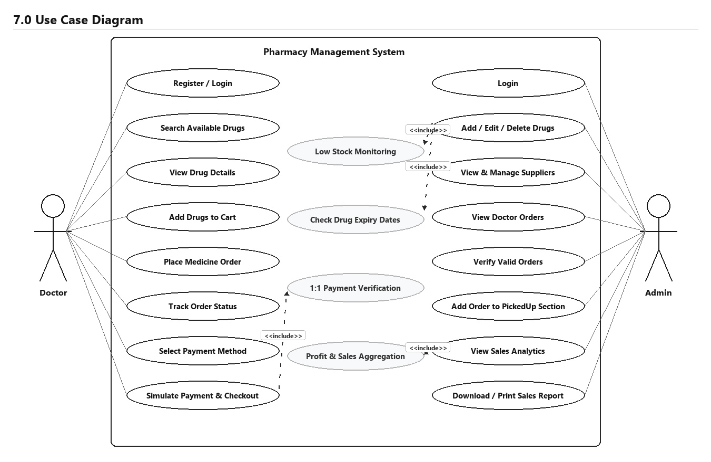
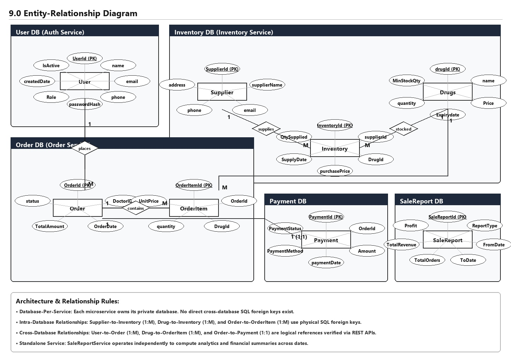
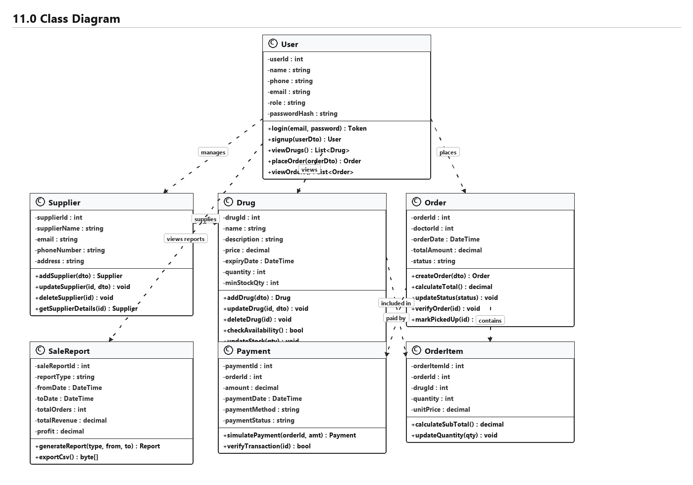

# Pharmacy Management System (Microservices POC) — Low Level Design (LLD)

**Project Name:** Pharmacy Management System  
**Architecture:** Microservices Architecture (5 Services + YARP API Gateway)  
**Date:** 19/11/2026  
**Current Document Version:** [1.0]  
**Author:** Lahari Chikoti  

---

## Document Approval
### Approvers of this document
| Name | Department | Role | Signature | Date |
|---|---|---|---|---|
| Lahari Chikoti | Engineering | Lead Architect / Author | *Approved* | 19/11/2026 |
| Technical Review Board | Architecture | Enterprise Review | *Approved* | 19/11/2026 |

### Document Change History
| Document Version # | Author | Date | Description |
|---|---|---|---|
| 1.0 | Lahari Chikoti | 19/11/2026 | Pharmacy Management System Final Low Level Design (LLD) |

---

## Table of Contents
| Section | Title | Page No. |
|---|---|---|
| 1.0 | Document Purpose | 4 |
| 2.0 | Intended Audience | 4 |
| 3.0 | Project Background and Objectives | 5 |
| 4.0 | Requirements | 5 |
| 5.0 | Design Patterns | 7 |
| 6.0 | Architecture Diagram | 8 |
| 7.0 | Use Case Diagram | 9 |
| 8.0 | Entity-Relationship Diagram | 10 |
| 9.0 | Database Diagram | 11 |
| 10.0 | Class Diagram | 12 |
| 11.0 | Solution Steps | 13 |
| 12.0 | Classes Names | 15 |
| 13.0 | Validations | 18 |
| 14.0 | API Catalogue | 18 |
| 15.0 | HTTP Status Codes | 19 |
| 16.0 | Integrations | 20 |
| 17.0 | Sample API Requests | 21 |
| 18.0 | Sample API Responses | 22 |
| 19.0 | NUnit Unit Testing | 23 |

---

## 1.0 Document Purpose
This document describes the Low-Level Design (LLD) of the Pharmacy Management System. The system is built using C#, ASP.NET Core Web API, .NET 10, and a microservices architecture. It defines the service layout, database tables, business rules, validations, APIs, and unit testing approach.

The application has five independent services: Auth Service, Inventory Service, Order Service, Payment Service, and SaleReport Service. Each service owns its private database. Services talk to each other through REST APIs, while the YARP API Gateway routes client requests. Swagger UI is used to test and document all endpoints.

---

## 2.0 Intended Audience
This document serves as a guide for project stakeholders:
| Role | Engagement in Pharmacy Management Architecture |
|---|---|
| **Product Owners / SMEs** | Confirm that the design covers all pharmacy requirements. |
| **Business Analysts** | Map doctor and admin business workflows to technical APIs. |
| **Enterprise Architects** | Review microservice boundaries, security rules, and database isolation. |
| **Solution Architects** | Check the API contracts, service communications, and data flow. |
| **Developers & QA Engineers** | Use this document to implement features and write unit tests. |

---

## 3.0 Project Background and Objectives

### 3.1 Project Background
Pharmacies need reliable software to manage medicine stocks, drug suppliers, doctor prescription orders, and sales accounting. Handling these records manually leads to misplaced orders, billing errors, or stock shortages. The Pharmacy Management System provides a clean backend solution. Doctors can check available medicines, add items to cart, place orders, and cancel orders before payment or pickup. Admins can manage medicines, track supplier deliveries, verify orders, and view profit and sales reports.

### 3.2 Project Objective
The objective is to develop a reliable and modular backend using C#, ASP.NET Core Web API, .NET 10, and microservices architecture. Key goals include:
- Dividing operations into five services with separate SQL databases.
- Securing endpoints using JWT Bearer authentication and role checks (Admin and Doctor).
- Enabling doctors to register and browse medicines, place orders, simulate payments, and cancel orders prior to payment completion.
- Ensuring administrators cannot register; Admin credentials are pre-seeded in the database and administrators can only log in.
- Enabling admins to manage inventory, verify orders, and review sales analytics.
- Enforcing database migrations for seamless Code-First database versioning.
- Documenting all endpoints in Swagger UI and validating logic with NUnit tests.

---

## 4.0 Requirements

### 4.1 Functional Requirements (FR)
| FR ID | Module | Functional Requirement | Description |
|---|---|---|---|
| **FR-01** | Authentication | User Registration | The system shall allow Doctor users to register using name, email, contact number, and password. Administrator registration is prohibited; Admin credentials are pre-seeded in the database and Admin can only log in. |
| **FR-02** | Authentication | User Login | The system shall authenticate users using email and password and generate a JWT token upon successful login. |
| **FR-03** | Authentication | Role-Based Access Control | The system shall restrict API access based on user roles such as Admin and Doctor. |
| **FR-04** | Authentication | View Current User | The system shall allow authenticated users to view their profile details using the current user endpoint (`/api/auth/current-user`). |
| **FR-05** | Drug Management | Add Drug | The Admin shall be able to add new drugs with details such as name, category, purchase price, selling price, and stock information. |
| **FR-06** | Drug Management | Update Drug | The Admin shall be able to modify existing drug details. |
| **FR-07** | Drug Management | Delete Drug | The Admin shall be able to remove a drug from the system. |
| **FR-08** | Drug Management | View Drugs | The system shall display all available drugs and their details. |
| **FR-09** | Supplier Management | Add Supplier | The Admin shall be able to add supplier information to the system. |
| **FR-10** | Supplier Management | Update Supplier | The Admin shall be able to update supplier details. |
| **FR-11** | Supplier Management | View Suppliers | The system shall provide access to supplier information. |
| **FR-12** | Inventory Management | Stock Inward | The Admin shall be able to add stock received from suppliers into inventory. |
| **FR-13** | Inventory Management | View Inventory | The system shall display current inventory quantities for all medicines. |
| **FR-14** | Inventory Management | Low Stock Monitoring | The system shall identify medicines whose stock quantity is less than or equal to the minimum stock level. |
| **FR-15** | Inventory Management | Stock Deduction | The system shall deduct medicine stock automatically when orders are placed. |
| **FR-16** | Inventory Management | Stock Validation | The system shall prevent orders when requested quantities exceed available stock or when medicine is expired. |
| **FR-17** | Order Management | Create Order | Doctors shall be able to create medicine orders by selecting available medicines and quantities. |
| **FR-18** | Order Management | Calculate Order Total | The system shall automatically calculate the total order amount based on selected medicines. |
| **FR-19** | Order Management | View Order History | Doctors shall be able to view their previous orders. |
| **FR-20** | Order Management | Verify Order | The Admin shall be able to verify pending orders before pickup. |
| **FR-21** | Order Management | Pick Up Order | The Admin shall be able to mark verified orders as picked up. |
| **FR-22** | Order Management | Cancel Order | Doctors shall be able to cancel orders before payment is successful and before pickup, automatically releasing reserved stock back to inventory. |
| **FR-23** | Payment Management | Simulate Payment | The system shall simulate payment processing without integrating an actual payment gateway. |
| **FR-24** | Payment Management | Record Payment | The system shall create a payment record after successful payment simulation. Cancelled orders cannot be paid. |
| **FR-25** | Payment Management | Prevent Duplicate Payments | The system shall ensure only one payment record exists per order (1:1 constraint). |
| **FR-26** | Sales Reporting | Generate Sales Report | The system shall generate sales reports for a specified date range. |
| **FR-27** | Sales Reporting | Calculate Revenue | The system shall calculate total revenue from completed orders. |
| **FR-28** | Sales Reporting | Calculate Profit | The system shall calculate profit using the formula: Profit = Selling Price − Purchase Price. |
| **FR-29** | Sales Reporting | Export Reports | The system shall allow sales reports to be exported in CSV format. |

### 4.2 Non-Functional Requirements
| NFR ID | Non-Functional Requirement | Description |
|---|---|---|
| **NFR-01** | Microservices Architecture | The system shall be implemented using independent microservices (Auth, Inventory, Order, Payment, SaleReport) plus YARP Gateway, each service maintaining its private database. |
| **NFR-02** | Scalability | Each microservice shall be independently deployable and scalable without affecting other services. |
| **NFR-03** | Security | Protected APIs shall require a valid JWT Bearer Token for authentication and authorization. |
| **NFR-04** | Role-Based Access Control | The system shall restrict access to APIs based on user roles such as Admin and Doctor. |
| **NFR-05** | Data Isolation | Each microservice shall maintain a dedicated database to ensure loose coupling and data independence. |
| **NFR-06** | RESTful Communication | Services shall communicate using REST APIs over HTTP following standard REST principles. |
| **NFR-07** | Service Communication | Inter-service communication shall be performed synchronously using Typed HTTP Clients. |
| **NFR-08** | API Gateway | YARP API Gateway shall act as a single entry point and route requests to the appropriate microservices. |
| **NFR-09** | Availability | The application shall be available during operating hours with minimal downtime. |
| **NFR-10** | Validation | The system shall validate user input before processing requests and prevent invalid data from being stored. |
| **NFR-11** | Error Handling | The system shall provide meaningful error messages and appropriate HTTP status codes such as 200, 201, 400, 401, 404, and 500. |

### 4.3 Technology Stack
| Category | Technology | Purpose |
|---|---|---|
| **Language** | C# 12 | Primary programming language for all services. |
| **Framework** | ASP.NET Core Web API | Framework used to build RESTful microservice APIs. |
| **Runtime** | .NET 10 | Cross-platform runtime to build and run the services. |
| **ORM** | Entity Framework Core 8 | Maps C# models to SQL tables using Code-First approach with Migrations. |
| **Database** | Microsoft SQL Server 2022 | Hosts 5 separate databases for microservice data isolation. |
| **Security** | JWT & PBKDF2 | Authenticates users and hashes passwords securely. |
| **Authorization** | Role-Based Access (RBAC) | Restricts API access based on Admin and Doctor roles. |
| **API Gateway** | YARP | Routes incoming requests to the appropriate microservices. |
| **API Documentation** | Swagger / OpenAPI 3.0 | Documents and interactively tests backend APIs. |
| **Testing** | NUnit & Moq | Automated unit test suite verifying service layer business logic. |

---

## 5.0 Design Patterns
The architecture uses standard enterprise design patterns to maintain clean separation of concerns:
| Name | Description |
|---|---|
| **REST API** | HTTP-based REST APIs are used for client calls and service-to-service communication. |
| **Microservices Architecture** | The system is divided into five independent services: Auth, Inventory, Order, Payment, and SaleReport. |
| **Layered Architecture** | Each microservice follows a Controller, Service, and Repository structure to separate concerns. |
| **Repository Pattern** | Repositories handle database access, keeping data logic separate from business rules. |
| **Dependency Injection** | Services and repositories are injected via built-in DI containers for testability. |
| **Database per Service** | Each microservice owns its private database. No direct cross-service SQL joins are allowed. |
| **API Gateway Pattern** | YARP provides a centralized entry point and routes client requests to microservices. |
| **DTO Pattern** | Request and response DTOs define clean API contracts and prevent over-posting. |

---

## 6.0 Architecture Diagram


### Description
The solution architecture diagram shows how the different parts of the Pharmacy Management System work together. Users access the system through client applications and Swagger UI for API testing. All requests pass through the API Gateway, which routes them to the appropriate microservice and ensures that only authenticated users can access secured endpoints. The system consists of five microservices: Auth Service for user authentication, Inventory Service for managing medicines and suppliers, Order Service for cart and order management, Payment Service for payment simulation, and SalesReport Service for generating reports and profit analysis. Each microservice has its own dedicated SQL Server database and communicates with other services through APIs instead of direct database connections. This architecture keeps the system modular, scalable, and easy to maintain.

---

## 7.0 Use Case Diagram


### Description
The use case diagram shows how the two main users, Admin and Doctor, interact with the Pharmacy Management System. The Doctor user can register and log in securely whereas the Admin User can login securely. Doctors can view available medicines, add medicines to a cart, place orders, cancel orders before payment/pickup, perform payment simulation, track order status, and view order history. Admins manage medicines, suppliers, and inventory records. They can verify orders, mark orders as picked up, monitor low-stock and expired medicines, analyze profits, view top-selling drugs, and generate downloadable or printable sales reports. Overall, the diagram illustrates the complete workflow from ordering medicines to inventory management and business reporting.

---

## 8.0 Entity-Relationship Diagram


### Description
The Entity Relationship (ER) Diagram shows how the Pharmacy Management System stores and connects data across different microservices. The User Database stores user information for Admins and Doctors. The Inventory Database manages drugs, suppliers, and inventory records. The Order Database stores orders and the medicines included in each order. The Payment Database stores payment simulation details, while the Sales Report Database stores generated sales reports. Relationships are maintained within the same database, such as Supplier-Inventory and Order-OrderItem. Since each microservice has its own database, cross-service relationships are handled through identifiers like UserId, DrugId, and OrderId and validated through API communication rather than direct database joins. This ensures service independence, scalability, and easier maintenance.

---

## 9.0 Database Diagram


### Description
The database diagram shows how data is stored across the five databases used in the Pharmacy Management System. The User Database stores user information such as login details, contact information, and roles. The Inventory Database manages medicines, suppliers, stock quantities, purchase prices, and inventory records. The Order Database stores orders placed by doctors along with the medicines included in each order. The Payment Database maintains payment simulation records for orders, while the Sales Report Database stores generated sales reports, revenue details, and profit summaries. Each database is owned by its respective microservice, and services communicate with one another through APIs instead of direct database connections. This approach keeps the system organized, scalable, and easy to maintain.

---

## 10.0 Class Diagram


### Description
The class diagram shows the main entities in the Pharmacy Management System and how they work together. The User class manages registration, login, and user roles. The Drug, Supplier, and Inventory classes handle medicine and stock management. The Order and OrderItem classes manage carts, orders, and order status updates. The Payment class stores payment simulation details, while the SalesReport class generates sales, revenue, and profit reports. Together, these classes support the complete workflow from managing medicines and placing orders to processing payments and generating reports.

---

## 11.0 Solution Steps

### 11.1 User Registration and Login
Users can create an account by providing their name, contact number, email address, password, and role (Doctor) and the Admin can login. The system strictly prohibits Administrator registration; Admin credentials (`admin@pharmacy.com` / `Admin@123`) are pre-seeded in the database. Once registered, doctors can log in using their email and password. After successful authentication, the system generates a secure token that allows users to access protected features based on their role.

### 11.2 Admin Manages Drugs and Suppliers
After logging in, the Admin can manage medicines, suppliers, and inventory records. The Admin can add new medicines, update existing medicine details, remove discontinued medicines, register suppliers, and record incoming stock. The system automatically updates stock quantities and helps monitor inventory levels.

### 11.3 Doctor Views Drugs and Adds to Cart
The Doctor can browse available medicines, view details such as price, stock availability, and expiry date, and select the medicines required. Selected medicines can be added to a cart before proceeding to checkout. The system calculates the order amount based on the selected medicines and quantities.

### 11.4 Doctor Places Order, Cancels Order or Simulates Payment
When the Doctor confirms the cart, the order is created and moved to the Pending status. The system checks stock availability and updates inventory accordingly. If the doctor decides not to proceed, **the doctor is able to cancel the order before payment is successful**, which transitions the order status to Cancelled and automatically releases the reserved medicine stock back to inventory. If proceeding, the Doctor completes a payment simulation by selecting a payment method such as UPI, Card, Net Banking, or Cash. The system validates that the payment amount matches the order total and prevents payment on cancelled orders.

### 11.5 Admin Verifies Order and Marks Picked Up
The Admin reviews orders placed by doctors and verifies their validity. Once verified, the order status is updated to Verified. After the medicines are handed over to the doctor or customer, the Admin marks the order as PickedUp, indicating successful order completion. Orders cannot be cancelled after they are marked as PickedUp.

### 11.6 Admin Generates and Downloads Sales Reports
The Admin can generate sales reports for a selected period such as Daily, Weekly, Monthly, or Yearly. The system calculates total sales, revenue, and profit and displays the results in a report. Reports can also be downloaded or printed for record-keeping and analysis purposes.

---

## 12.0 Classes Names

### Entities (Models)
| S.No | Class Name | Description |
|---|---|---|
| 1 | `User.cs` | Represents user account information, password hash, and assigned role (Admin or Doctor). |
| 2 | `Drug.cs` | Represents medicine details, description, selling price, expiry date, quantity, and minimum stock limit. |
| 3 | `Supplier.cs` | Represents supplier contact information, email, phone number, and address. |
| 4 | `Inventory.cs` | Represents incoming stock shipments, purchase prices, supply dates, and supplier links. |
| 5 | `Order.cs` | Represents prescription orders placed by doctors, order date, total amount, and status. |
| 6 | `OrderItem.cs` | Represents individual medicine line items belonging to an order with unit price. |
| 7 | `Payment.cs` | Represents simulated payment records with 1:1 order linking and payment status details. |
| 8 | `SaleReport.cs` | Represents financial sales reports, total order counts, revenue, and profit calculations. |

### Controllers (API Layer)
| S.No | Class Name | Description |
|---|---|---|
| 1 | `AuthController.cs` | Handles user registration (Doctor only), login, and profile retrieval APIs. |
| 2 | `DrugsController.cs` | Handles drug retrieval, creation, updates, deletion, stock restoration, and low-stock alerts. |
| 3 | `SuppliersController.cs` | Handles supplier registration, retrieval, and profile updates. |
| 4 | `InventoryController.cs` | Handles stock inward shipments, inventory updates, and stock deduction. |
| 5 | `OrdersController.cs` | Handles order creation, status tracking, admin verification, cancellation, and pickup handover. |
| 6 | `PaymentsController.cs` | Handles checkout payment simulation and transaction verification. |
| 7 | `SaleReportsController.cs` | Handles sales report generation, profit analytics, and CSV download APIs. |

### Services (Business Logic)
| S.No | Class Name | Description |
|---|---|---|
| 1 | `AuthService.cs` | Implements doctor registration, admin registration blocking, password verification, and login logic. |
| 2 | `TokenService.cs` | Generates signed JWT tokens with user claims and expiration. |
| 3 | `DrugService.cs` | Handles medicine availability checks, stock updates, stock restoration, and low-stock alerts. |
| 4 | `SupplierService.cs` | Manages supplier records, contact updates, and vendor associations. |
| 5 | `OrderService.cs` | Coordinates order creation, stock reservation, order cancellation with stock release, verification, and handover. |
| 6 | `PaymentService.cs` | Simulates payment processing, enforces 1:1 transaction rules, and prevents payment on cancelled orders. |
| 7 | `SaleReportService.cs` | Computes revenue, purchase costs, profit, and builds CSV report files. |

### Repositories (Data Access Layer)
| S.No | Class Name | Description |
|---|---|---|
| 1 | `UserRepository.cs` | Manages database operations for user accounts in User DB. |
| 2 | `DrugRepository.cs` | Handles CRUD database queries for medicines in Inventory DB. |
| 3 | `SupplierRepository.cs` | Manages database queries for supplier records in Inventory DB. |
| 4 | `InventoryRepository.cs` | Manages stock inward entries and inventory records in Inventory DB. |
| 5 | `OrderRepository.cs` | Handles order and order item queries with EF Core in Order DB. |
| 6 | `PaymentRepository.cs` | Saves and queries payment records with unique order IDs in Payment DB. |
| 7 | `SaleReportRepository.cs` | Stores and queries sales summary records in SaleReport DB. |

---

## 13.0 Validations
1. **Admin Registration Prevention:** The system prevents registration of Admin accounts; only Doctor registration is allowed. Admin credentials are pre-seeded.
2. **Unique Email Validation:** Prevent registration using an email address that already exists in the system.
3. **Password Policy Validation:** Password must meet minimum length and complexity requirements.
4. **Medicine Price Validation:** Purchase Price and Selling Price must be greater than zero.
5. **Stock Quantity Validation:** Stock quantity cannot be negative during creation or updates.
6. **Supplier Validation:** A drug can only be associated with an existing supplier.
7. **Inventory Inward Validation:** Inward stock quantity must be greater than zero.
8. **Order Quantity Validation:** Ordered quantity must be greater than zero.
9. **Order Existence Validation:** Payment, verification, pickup, and cancellation actions can only be performed on existing orders.
10. **Order Cancellation Validation:** Orders can be cancelled before payment and before pickup; reserved stock is released back to inventory. Orders cannot be cancelled after they have been marked as PickedUp.
11. **Payment Cancellation Protection:** Payments cannot be processed or simulated for orders that have been cancelled.
12. **Payment Amount Validation:** Payment amount must match the calculated order total.
13. **Date Range Validation:** Sales report start date must be earlier than or equal to the end date.
14. **Drug Availability Validation:** Orders can only include medicines that are active, in stock, and not expired.
15. **Duplicate Drug Validation:** Prevent creation of duplicate medicines with the same name and manufacturer combination.
16. **JWT Expiration Validation:** Expired JWT tokens must be rejected and require re-authentication.
17. **Required Entity Validation:** Drug, Supplier, User, and Order IDs supplied in requests must exist before processing.

---

## 14.0 API Catalogue
The table below lists all endpoints exposed by the microservices (routed through YARP API Gateway):

### 1. User DB (Auth Service)
**Table: Users**
| Endpoint | Method | Access | Description |
|---|---|---|---|
| `/api/auth/register` | POST | Public | Register a new Doctor account (Admin registration disallowed) |
| `/api/auth/login` | POST | Public | Authenticate user (Admin or Doctor) and generate JWT token |
| `/api/auth/current-user` | GET | Admin / Doctor | Get details of currently logged-in user |
| `/api/auth/users` | GET | Admin | View all registered users |

### 2. Inventory DB (Inventory Service)
**Table: Drugs**
| Endpoint | Method | Access | Description |
|---|---|---|---|
| `/api/drugs` | GET | Admin / Doctor | Retrieve all available medicines |
| `/api/drugs/{id}` | GET | Admin / Doctor | Retrieve a specific medicine |
| `/api/drugs` | POST | Admin | Add a new medicine |
| `/api/drugs/{id}` | PUT | Admin | Update medicine details |
| `/api/drugs/{id}` | DELETE | Admin | Remove a medicine |
| `/api/drugs/low-stock` | GET | Admin | View medicines with low stock levels |
| `/api/drugs/restore-stock` | POST | Inter-Service | Restore stock when an order is cancelled |

**Table: Suppliers**
| Endpoint | Method | Access | Description |
|---|---|---|---|
| `/api/suppliers` | GET | Admin | View supplier details |
| `/api/suppliers` | POST | Admin | Add a new supplier |

**Table: Inventory**
| Endpoint | Method | Access | Description |
|---|---|---|---|
| `/api/inventory/inward` | POST | Admin | Add inward stock supplied by supplier |

### 3. Order DB (Order Service)
**Table: Orders**
| Endpoint | Method | Access | Description |
|---|---|---|---|
| `/api/orders` | POST | Doctor | Create a new medicine order (status: Pending) |
| `/api/orders` | GET | Admin | View all orders |
| `/api/orders/my-orders` | GET | Doctor | View doctor's own orders |
| `/api/orders/{id}` | GET | Admin / Doctor | View order details |
| `/api/orders/{id}/verify` | PUT | Admin | Verify a pending order |
| `/api/orders/{id}/pickup` | PUT | Admin | Mark order as picked up |
| `/api/orders/{id}/cancel` | PUT | Doctor / Admin | Cancel an order before payment/pickup and release stock |

### 4. Payment DB (Payment Service)
**Table: Payments**
| Endpoint | Method | Access | Description |
|---|---|---|---|
| `/api/payments/simulate` | POST | Doctor / Internal | Simulate payment and create payment record (1:1 constraint) |

### 5. SaleReport DB (SaleReport Service)
**Table: SaleReports**
| Endpoint | Method | Access | Description |
|---|---|---|---|
| `/api/salereports/generate` | POST | Admin | Generate sales and profit report |

---

## 15.0 HTTP Status Codes
| Status Code | Status | Description |
|---|---|---|
| **200** | OK | The request succeeded and returned the requested data. |
| **201** | Created | A new user, drug, order, payment, or report was created successfully. |
| **204** | No Content | The request succeeded and no response body is needed (e.g. deletion). |
| **400** | Bad Request | The request is invalid, missing data, or failed validation checks. |
| **401** | Unauthorized | The JWT token is missing, expired, or invalid. |
| **403** | Forbidden | The user does not have permission for this action (e.g. Doctor calling Admin API). |
| **404** | Not Found | The requested drug, order, supplier, or user record was not found. |
| **409** | Conflict | A conflict occurred, such as duplicate email or duplicate payment for an order. |
| **500** | Internal Server Error | An unexpected error occurred while processing the request. |

---

## 16.0 Integrations
- **YARP API Gateway:** Provides a central entry point (`http://localhost:5000`) and routes client requests to the appropriate microservice.
- **REST APIs:** Enable synchronous communication between Order, Inventory, and Payment services using typed HTTP clients.
- **JWT Bearer Authentication:** Secures APIs with signed tokens and supports role-based access for Admin and Doctor.
- **SQL Server 2022:** Maintains five separate databases ensuring data isolation per service.
- **Entity Framework Core 8 with Migrations:** Manages database schema versioning and Code-First automatic migration application upon startup.
- **Swagger UI:** Provides interactive API documentation and testing for all microservices and the API Gateway.
- **NUnit:** Automated unit test suite verifying service layer logic using mocked dependencies.

---

## 17.0 Sample API Requests
**Sample POST request to create an order (`/api/orders`):**
```json
{
  "doctorId": 2,
  "items": [
    {
      "drugId": 1,
      "drugName": "Paracetamol 500mg",
      "quantity": 2,
      "unitPrice": 9.99
    },
    {
      "drugId": 3,
      "drugName": "Ibuprofen 400mg",
      "quantity": 1,
      "unitPrice": 12.00
    }
  ]
}
```

---

## 18.0 Sample API Responses
**Successful response returned after order creation (Status Code: 201 Created):**
```json
{
  "statusCode": 201,
  "message": "Order created successfully",
  "data": {
    "orderId": 101,
    "doctorId": 2,
    "orderDate": "2026-11-19T10:30:00Z",
    "totalAmount": 31.98,
    "status": "Pending",
    "orderItems": [
      {
        "orderItemId": 201,
        "drugId": 1,
        "drugName": "Paracetamol 500mg",
        "quantity": 2,
        "unitPrice": 9.99
      },
      {
        "orderItemId": 202,
        "drugId": 3,
        "drugName": "Ibuprofen 400mg",
        "quantity": 1,
        "unitPrice": 12.00
      }
    ]
  }
}
```

---

## 19.0 NUnit Unit Testing
The unit testing suite validates key business logic and error scenarios using NUnit:
| Test Case ID | Test Case Scenario | Test Case Pre Condition | Test Steps | Test Data |
|---|---|---|---|---|
| **TC-01** | Register user with valid details | Auth service is running and database is connected | 1. Open Swagger. 2. Call Register API. 3. Enter valid user details. 4. Submit request. | Name: Doctor1, Email: doctor@test.com, Password: Test@123, Role: Doctor |
| **TC-02** | Register with duplicate email | User with email already exists | 1. Call Register API. 2. Enter existing email. 3. Submit request. | Email: doctor@test.com |
| **TC-03** | Login with valid credentials | Registered user exists | 1. Call Login API. 2. Enter valid credentials. 3. Submit request. | Email: doctor@test.com, Password: Test@123 |
| **TC-04** | Login with incorrect password | Registered user exists | 1. Call Login API. 2. Enter invalid password. 3. Submit request. | Email: doctor@test.com, Password: Wrong123 |
| **TC-05** | Add medicine with valid details | Admin is authenticated | 1. Call Add Drug API. 2. Enter valid medicine details. 3. Submit request. | Paracetamol, Price: 10, Stock: 100 |
| **TC-06** | Add medicine with negative price | Admin is authenticated | 1. Call Add Drug API. 2. Enter negative price. 3. Submit request. | Price: -10 |
| **TC-07** | Update medicine price and stock | Medicine already exists | 1. Call Update Drug API. 2. Modify values. 3. Submit request. | Price: 15, Stock: 120 |
| **TC-08** | Query medicines below minimum stock | Medicines exist in inventory | 1. Call Get Low Stock API. 2. Execute request. | Min Stock: 10 |
| **TC-09** | Deduct stock when sufficient quantity exists | Medicine stock is available | 1. Call Stock Deduction API. 2. Enter quantity. 3. Submit request. | Current Stock: 100, Deduct: 20 |
| **TC-10** | Deduct stock when insufficient quantity exists | Available stock is less than requested quantity | 1. Call Stock Deduction API. 2. Enter excessive quantity. 3. Submit request. | Current Stock: 10, Deduct: 20 |
| **TC-11** | Create order with valid items | Doctor is logged in and medicines exist | 1. Call Create Order API. 2. Add medicines. 3. Submit request. | DrugId: 1, Quantity: 2 |
| **TC-12** | Create order with empty cart | Doctor is logged in | 1. Call Create Order API. 2. Submit without items. | Empty Cart |
| **TC-13** | Doctor views own order history | Doctor has previous orders | 1. Login as doctor. 2. Call Order History API. | DoctorId: 1 |
| **TC-14** | Admin verifies pending order | Order status is Pending | 1. Call Verify Order API. 2. Enter Order Id. 3. Submit request. | OrderId: 1 |
| **TC-15** | Admin marks order as picked up | Order status is Verified | 1. Call Pick Up API. 2. Enter Order Id. 3. Submit request. | OrderId: 1 |
| **TC-16** | Doctor cancels order before pickup | Order status is Pending or Verified | 1. Call Cancel Order API. 2. Enter Order Id. 3. Submit request. | OrderId: 2 |
| **TC-17** | Simulate payment for pending order | Pending order exists | 1. Call Simulate Payment API. 2. Enter Order Id. 3. Submit request. | OrderId: 1, Amount: 500 |
| **TC-18** | Simulate duplicate payment | Payment already exists for order | 1. Call Simulate Payment API again. 2. Submit request. | OrderId: 1 |
| **TC-19** | Generate sales report for date range | Orders and payments exist | 1. Call Generate Report API. 2. Enter date range. 3. Submit request. | From: 01-11-2026, To: 30-11-2026 |
| **TC-20** | Export sales report to CSV | Sales report is generated | 1. Call Export CSV API. 2. Submit request. | Date Range: Monthly |
| **TC-21** | Register with invalid email format | Auth service is running | 1. Call Register API. 2. Enter invalid email. 3. Submit request. | Email: doctortest.com |
| **TC-22** | Register with missing required fields | Auth service is running | 1. Call Register API. 2. Leave Name field empty. 3. Submit request. | Name: "", Email: doctor@test.com |
| **TC-23** | Access protected API without JWT token | Protected API exists | 1. Call Get Drugs API without token. | No Authorization Header |
| **TC-24** | Access Admin API using Doctor role | Doctor user is authenticated | 1. Login as Doctor. 2. Call Verify Order API. | Doctor JWT Token |
| **TC-25** | Add inventory inward stock | Admin is authenticated | 1. Call Inventory Inward API. 2. Enter valid quantity. 3. Submit request. | DrugId: 1, Quantity: 50 |
| **TC-26** | Create order for expired medicine | Expired medicine exists | 1. Call Create Order API. 2. Select expired medicine. 3. Submit request. | DrugId: 5 (Expired) |
| **TC-27** | Cancel order after pickup | Order status is PickedUp | 1. Call Cancel Order API. 2. Enter Order Id. | OrderId: 1 |
| **TC-28** | Simulate payment with incorrect amount | Pending order exists | 1. Call Payment API. 2. Enter incorrect amount. 3. Submit request. | Order Total: 500, Payment: 300 |
| **TC-29** | Generate report with invalid date range | Orders exist | 1. Call Report API. 2. Enter End Date earlier than Start Date. | From: 30-11-2026, To: 01-11-2026 |
| **TC-30** | Export report when no sales data exists | No sales during selected period | 1. Call Export CSV API. 2. Select empty date range. | Future Date Range |
