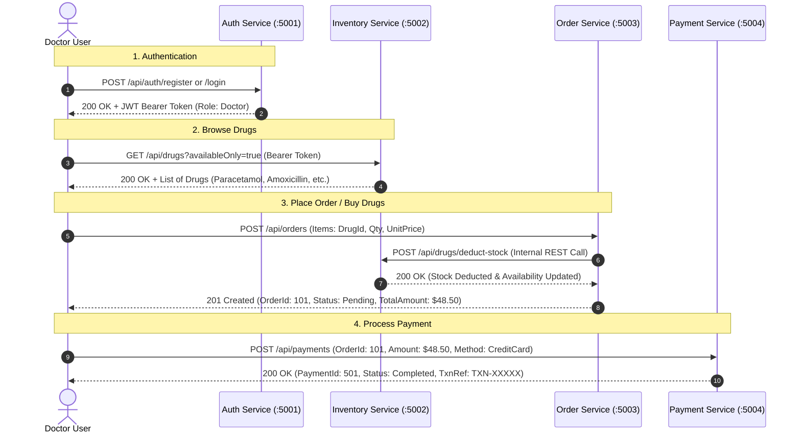
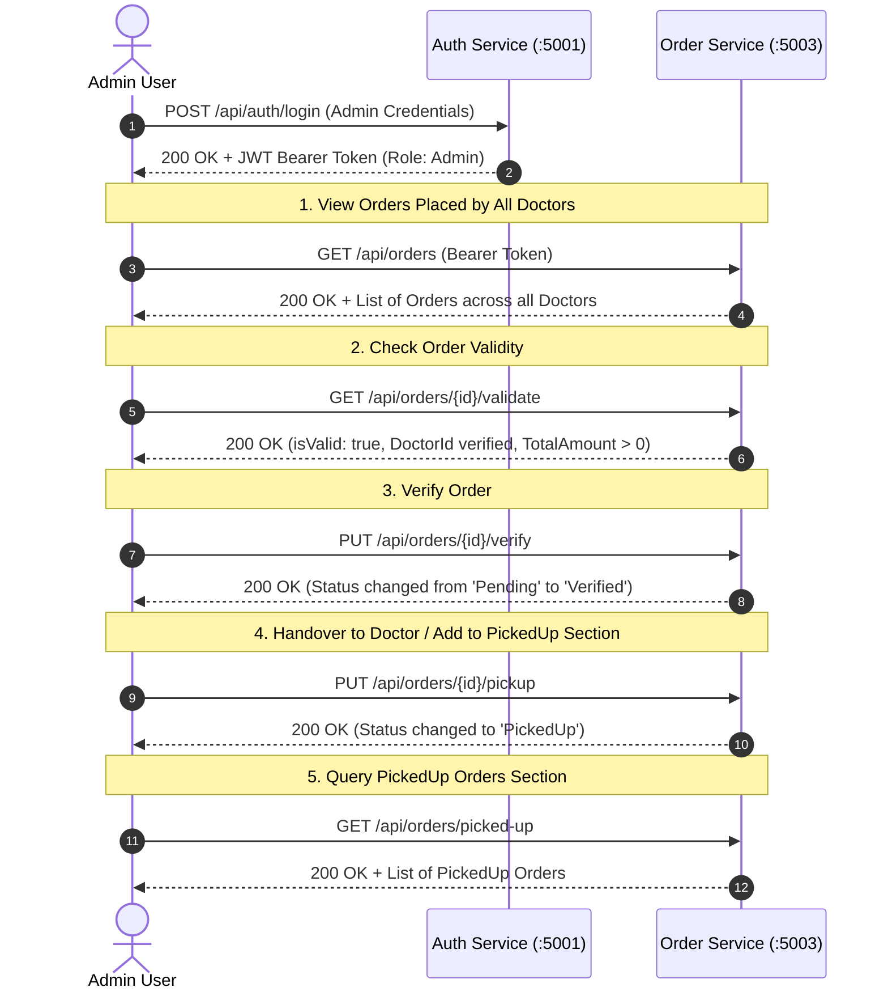
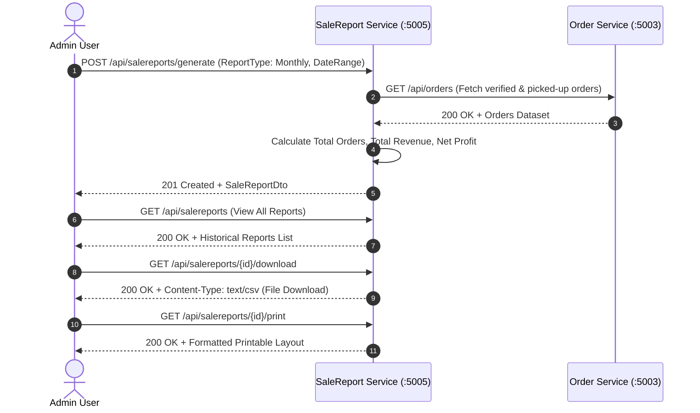
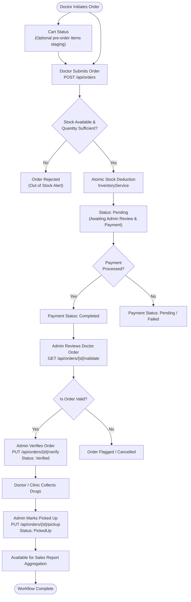
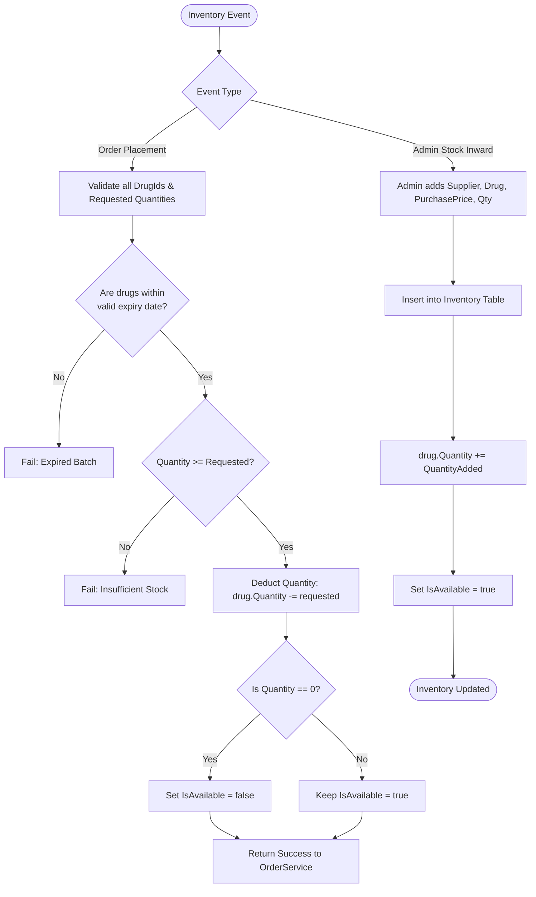
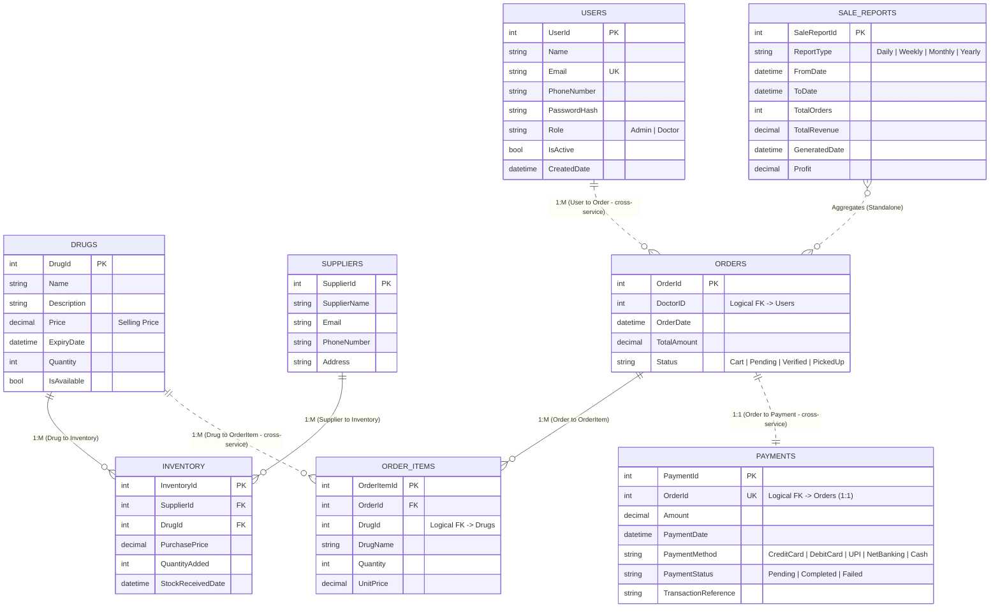

# Pharmacy Management System - Low Level Design (LLD) & Technical Architecture

## Architectural Diagrams (High-Resolution JPG Format - Enlarged All-Bold Content)

All 6 architectural diagrams have been generated in **ultra-high-resolution JPG format (3200px width)** using an enterprise color palette and **strictly BOLD typography (Segoe UI Bold, 20pt to 44pt)** so that every service name, table name, column attribute, flow step, and card title is clearly visible without needing to zoom in.

| Diagram | Link to High-Res JPG | Resolution / Format | Content Typography Enhancements |
| :--- | :--- | :--- | :--- |
| **1. Solution Architecture Diagram** | [01_Solution_Architecture_Diagram.jpg](file:///c:/Users/chikoti%20lahari/OneDrive/Desktop/pharmacyManagement/docs/diagrams/01_Solution_Architecture_Diagram.jpg) | 3200x2200 JPG | All Service Titles, DB Cylinders, Tech Stack, Execution Steps in **Bold 22-42pt** |
| **2. Use Case Diagram** | [02_Use_Case_Diagram.jpg](file:///c:/Users/chikoti%20lahari/OneDrive/Desktop/pharmacyManagement/docs/diagrams/02_Use_Case_Diagram.jpg) | 3200x2450 JPG | Stick Figure Actor Badges & 19 Use Case Ovals in **Bold 20-32pt** |
| **3. Sequence Diagrams** | [03_Sequence_Diagram.jpg](file:///c:/Users/chikoti%20lahari/OneDrive/Desktop/pharmacyManagement/docs/diagrams/03_Sequence_Diagram.jpg) | 3200x2550 JPG | 7 Lifeline Headers & 24 Step Banners with Number Badges in **Bold 20-26pt** |
| **4. Flow Diagram** | [04_Flow_Diagram.jpg](file:///c:/Users/chikoti%20lahari/OneDrive/Desktop/pharmacyManagement/docs/diagrams/04_Flow_Diagram.jpg) | 3200x2550 JPG | Role Decision Diamonds, Admin & Doctor Branch Nodes in **Bold 20-34pt** |
| **5. Entity-Relationship (ER) Diagram** | [05_ER_Diagram.jpg](file:///c:/Users/chikoti%20lahari/OneDrive/Desktop/pharmacyManagement/docs/diagrams/05_ER_Diagram.jpg) | 3200x2450 JPG | 8 Relational Entities with PK/FK Badges & Cardinality Labels in **Bold 21-28pt** |
| **6. Database Schema Diagram** | [06_Database_Schema_Diagram.jpg](file:///c:/Users/chikoti%20lahari/OneDrive/Desktop/pharmacyManagement/docs/diagrams/06_Database_Schema_Diagram.jpg) | 3200x2400 JPG | 5 Database Group Containers, Table Columns & Summary Tables in **Bold 20-28pt** |

---

## 1. Executive Summary & Solution Overview

The **Pharmacy Management System** is an enterprise-grade, distributed microservices platform built using **.NET 8, C#, Entity Framework Core (EF Core), LINQ, ASP.NET Core Web API, and Microsoft SQL Server**. 

Each microservice encapsulates a cohesive bounded context following **Domain-Driven Design (DDD)** and an internal **MVC (Model-View-Controller / Controller-Service-Repository) pattern**. Cross-cutting concerns such as **JWT Bearer Authentication & Role-Based Access Control (RBAC)**, unified API response formatting, and inter-service HTTP communications are centralized cleanly.

Per specifications, this system contains **no front-end UI**; all endpoints, authentication flows, and business transactions are tested directly through interactive **Swagger / OpenAPI** interfaces.

---

## 2. Solution Architecture Diagram

```mermaid
flowchart TB
    subgraph Clients["Clients & Testing"]
        Swagger["Swagger UI / OpenAPI<br/>(Interactive API Testing)"]
        DoctorUser["Doctor User"]
        AdminUser["Admin User"]
    end

    subgraph Security["Authentication & Access Control"]
        JWT["JWT Bearer Token<br/>(Claims: UserId, Name, Email, Role)"]
    end

    subgraph Microservices["Pharmacy Microservices Architecture (.NET 8 Web APIs)"]
        subgraph AuthMS["1. Auth Service (Port 5001)"]
            AuthCtrl["AuthController"]
            AuthSvc["AuthService"]
            AuthRepo["UserRepository"]
            AuthContext["AuthDbContext"]
        end

        subgraph InventoryMS["2. Inventory Service (Port 5002)"]
            DrugCtrl["DrugsController"]
            SuppCtrl["SuppliersController"]
            InvCtrl["InventoryController"]
            InvSvc["Drug / Supplier / Inventory Services"]
            InvRepo["Drug / Supplier / Inventory Repositories"]
            InvContext["InventoryDbContext"]
        end

        subgraph OrderMS["3. Order Service (Port 5003)"]
            OrderCtrl["OrdersController"]
            OrderSvc["OrderService"]
            InvClient["InventoryHttpClient"]
            OrderRepo["OrderRepository"]
            OrderContext["OrderDbContext"]
        end

        subgraph PaymentMS["4. Payment Service (Port 5004)"]
            PayCtrl["PaymentsController"]
            PaySvc["PaymentService"]
            PayRepo["PaymentRepository"]
            PayContext["PaymentDbContext"]
        end

        subgraph ReportMS["5. SaleReport Service (Port 5005)"]
            ReportCtrl["SaleReportsController"]
            ReportSvc["SaleReportService"]
            OrderClient["OrderHttpClient"]
            ReportRepo["SaleReportRepository"]
            ReportContext["SaleReportDbContext"]
        end
    end

    subgraph Databases["Dedicated SQL Server Databases"]
        UserDB[("User DB<br/>[Pharmacy_UserDB]")]
        InvDB[("Inventory DB<br/>[Pharmacy_InventoryDB]")]
        OrderDB[("Order DB<br/>[Pharmacy_OrderDB]")]
        PayDB[("Payment DB<br/>[Pharmacy_PaymentDB]")]
        ReportDB[("SaleReport DB<br/>[Pharmacy_SaleReportDB]")]
    end

    %% Client Interactions
    Swagger -->|HTTP Requests| AuthMS
    Swagger -->|HTTP Requests| InventoryMS
    Swagger -->|HTTP Requests| OrderMS
    Swagger -->|HTTP Requests| PaymentMS
    Swagger -->|HTTP Requests| ReportMS

    DoctorUser -.->|Bearer Token| Swagger
    AdminUser -.->|Bearer Token| Swagger

    %% Inter-service calls
    OrderSvc -->|HTTP REST: Deduct Stock| DrugCtrl
    ReportSvc -->|HTTP REST: Fetch Orders| OrderCtrl

    %% Database connections
    AuthContext -->|EF Core / LINQ| UserDB
    InvContext -->|EF Core / LINQ| InvDB
    OrderContext -->|EF Core / LINQ| OrderDB
    PayContext -->|EF Core / LINQ| PayDB
    ReportContext -->|EF Core / LINQ| ReportDB
```

---

## 3. Use Case Diagram

The system supports two core personas: **Admin** and **Doctor User**.

```mermaid
flowchart LR
    subgraph Actors["User Personas"]
        Admin(("Admin"))
        Doctor(("Doctor User"))
    end

    subgraph AuthCases["Authentication & Profiles"]
        UC1["Login / Signup (Name, Contact, Email, Password)"]
        UC2["Validate Doctor Role"]
        UC3["View All Users"]
    end

    subgraph InventoryCases["Drug & Inventory Management"]
        UC4["View Drugs & Drug Details"]
        UC5["Add Drug"]
        UC6["Edit Drug"]
        UC7["Delete Drug"]
        UC8["View Suppliers & Supplier Details"]
        UC9["Add Supplier"]
        UC10["Edit Supplier"]
        UC11["Delete Supplier"]
        UC12["Add Stock to Inventory"]
    end

    subgraph OrderCases["Order Processing"]
        UC13["Buy Drugs / Place Order"]
        UC14["View Doctor's Own Orders"]
        UC15["View All Doctor Orders"]
        UC16["Validate Order"]
        UC17["Verify Order"]
        UC18["Add Order to PickedUp Section"]
        UC19["View PickedUp Orders"]
    end

    subgraph PaymentCases["Payment Processing"]
        UC20["Process Payment for Order"]
        UC21["View Payment Transactions"]
    end

    subgraph ReportCases["Sales Reporting"]
        UC22["Generate Sales Report (Daily/Weekly/Monthly/Yearly)"]
        UC23["View Sales Reports"]
        UC24["Download Sales Report (CSV)"]
        UC25["Print Sales Report (Formatted Print View)"]
    end

    %% Doctor Relationships
    Doctor --> UC1
    Doctor --> UC4
    Doctor --> UC13
    Doctor --> UC14
    Doctor --> UC20

    %% Admin Relationships
    Admin --> UC1
    Admin --> UC3
    Admin --> UC4
    Admin --> UC5
    Admin --> UC6
    Admin --> UC7
    Admin --> UC8
    Admin --> UC9
    Admin --> UC10
    Admin --> UC11
    Admin --> UC12
    Admin --> UC15
    Admin --> UC16
    Admin --> UC17
    Admin --> UC18
    Admin --> UC19
    Admin --> UC21
    Admin --> UC22
    Admin --> UC23
    Admin --> UC24
    Admin --> UC25
```

---

## 4. Sequence Diagrams

### Sequence Diagram 1: Doctor User Journey (Signup, Browse, Order, Pay)

---

### Sequence Diagram 2: Admin Workflow (Validate, Verify, and Move to PickedUp)

---

### Sequence Diagram 3: Admin Sales Reporting & Export Workflow

---

## 5. Flow Diagrams

### Flow Diagram 1: Order Lifecycle State Machine

---

### Flow Diagram 2: Inventory Stock Deduction & Restock Flow

---

## 6. Entity-Relationship (ER) Diagram (Logical & Microservice Boundary)

---

## 7. Database Diagram (Physical Schemas)

```mermaid
classDiagram
    direction TB

    class Pharmacy_UserDB_Users {
        +int UserId [PK, Identity]
        +nvarchar(100) Name
        +nvarchar(150) Email [Unique Index]
        +nvarchar(20) PhoneNumber
        +nvarchar(255) PasswordHash
        +nvarchar(20) Role [Index: Admin/Doctor]
        +bit IsActive [Default: 1]
        +datetime2 CreatedDate [Default: GETUTCDATE()]
    }

    class Pharmacy_InventoryDB_Drugs {
        +int DrugId [PK, Identity]
        +nvarchar(150) Name
        +nvarchar(500) Description
        +decimal(18,2) Price [Selling Price]
        +datetime2 ExpiryDate
        +int Quantity
        +bit IsAvailable [Index, Default: 1]
    }

    class Pharmacy_InventoryDB_Suppliers {
        +int SupplierId [PK, Identity]
        +nvarchar(150) SupplierName
        +nvarchar(150) Email
        +nvarchar(20) PhoneNumber
        +nvarchar(300) Address
    }

    class Pharmacy_InventoryDB_Inventory {
        +int InventoryId [PK, Identity]
        +int SupplierId [FK -> Suppliers.SupplierId]
        +int DrugId [FK -> Drugs.DrugId]
        +decimal(18,2) PurchasePrice
        +int QuantityAdded
        +datetime2 StockReceivedDate [Default: GETUTCDATE()]
    }

    class Pharmacy_OrderDB_Orders {
        +int OrderId [PK, Identity]
        +int DoctorID [Index: Links to UserDB.Users.UserId]
        +datetime2 OrderDate [Default: GETUTCDATE()]
        +decimal(18,2) TotalAmount
        +nvarchar(20) Status [Index: Cart/Pending/Verified/PickedUp]
    }

    class Pharmacy_OrderDB_OrderItems {
        +int OrderItemId [PK, Identity]
        +int OrderId [FK -> Orders.OrderId, Cascade Delete]
        +int DrugId [Index: Links to InventoryDB.Drugs.DrugId]
        +nvarchar(150) DrugName
        +int Quantity
        +decimal(18,2) UnitPrice
    }

    class Pharmacy_PaymentDB_Payments {
        +int PaymentId [PK, Identity]
        +int OrderId [Unique Index: 1:1 with Orders.OrderId]
        +decimal(18,2) Amount
        +datetime2 PaymentDate [Default: GETUTCDATE()]
        +nvarchar(50) PaymentMethod
        +nvarchar(20) PaymentStatus [Index: Pending/Completed/Failed]
        +nvarchar(100) TransactionReference
    }

    class Pharmacy_SaleReportDB_SaleReports {
        +int SaleReportId [PK, Identity]
        +nvarchar(20) ReportType [Index: Daily/Weekly/Monthly/Yearly]
        +datetime2 FromDate
        +datetime2 ToDate
        +int TotalOrders
        +decimal(18,2) TotalRevenue
        +datetime2 GeneratedDate [Index, Default: GETUTCDATE()]
        +decimal(18,2) Profit
    }

    Pharmacy_InventoryDB_Suppliers "1" --> "*" Pharmacy_InventoryDB_Inventory : FK_Inventory_Suppliers
    Pharmacy_InventoryDB_Drugs "1" --> "*" Pharmacy_InventoryDB_Inventory : FK_Inventory_Drugs
    Pharmacy_OrderDB_Orders "1" --> "*" Pharmacy_OrderDB_OrderItems : FK_OrderItems_Orders
```

---

## 8. Microservice Details & Internal MVC Architecture

Each microservice is an ASP.NET Core Web API structured internally with MVC separation:
- **Controllers/**: Expose RESTful endpoints, validate inputs via `ModelState`, return standard `ApiResponse<T>`.
- **Models/**: Domain entities mapped to SQL Server tables via EF Core attributes and Fluent API.
- **DTOs/**: Strongly typed request/response contracts isolating domain models from external API exposure.
- **Repositories/**: Encapsulate data access logic using LINQ queries and EF Core `DbContext`.
- **Services/**: Implement business workflows, validations, computations, and inter-service HTTP communications.
- **Data/**: EF Core `DbContext`, Fluent API mappings, and automatic database seeders.

### Summary of Microservices Configuration

| Microservice | Default Port | Swagger URL | Database Name | Internal MVC Controller |
| :--- | :--- | :--- | :--- | :--- |
| **Auth Service** | `5001` | `http://localhost:5001/swagger` | `Pharmacy_UserDB` | `AuthController` |
| **Inventory Service** | `5002` | `http://localhost:5002/swagger` | `Pharmacy_InventoryDB` | `DrugsController`, `SuppliersController`, `InventoryController` |
| **Order Service** | `5003` | `http://localhost:5003/swagger` | `Pharmacy_OrderDB` | `OrdersController` |
| **Payment Service** | `5004` | `http://localhost:5004/swagger` | `Pharmacy_PaymentDB` | `PaymentsController` |
| **SaleReport Service**| `5005` | `http://localhost:5005/swagger` | `Pharmacy_SaleReportDB`| `SaleReportsController` |

---

## 9. Comprehensive API Endpoint Catalog & Swagger Testing Guide

### 9.1 Auth Service (`http://localhost:5001/swagger`)

| Method | Endpoint | Authorization | Description |
| :--- | :--- | :--- | :--- |
| `POST` | `/api/auth/register` | Anonymous | Register a new user (`Admin` or `Doctor`) |
| `POST` | `/api/auth/login` | Anonymous | Authenticate and obtain JWT Bearer Token |
| `GET` | `/api/auth/profile` | Authenticated | View logged-in user profile from token claims |
| `GET` | `/api/auth/validate-doctor/{doctorId}` | Anonymous | Verify if given ID belongs to an active Doctor |
| `GET` | `/api/auth/users` | `Admin` | View all registered users in system |
| `GET` | `/api/auth/users/{userId}`| Authenticated | View user details by ID |

### 9.2 Inventory Service (`http://localhost:5002/swagger`)

| Method | Endpoint | Authorization | Description |
| :--- | :--- | :--- | :--- |
| `GET` | `/api/drugs` | Anonymous / Any | View all drugs (`?availableOnly=true` supported) |
| `GET` | `/api/drugs/{id}` | Anonymous / Any | View details of a specific drug |
| `POST` | `/api/drugs` | `Admin` | Add a new drug |
| `PUT` | `/api/drugs/{id}` | `Admin` | Edit an existing drug |
| `DELETE`| `/api/drugs/{id}` | `Admin` | Delete a drug |
| `POST` | `/api/drugs/check-availability` | Anonymous | Check stock availability for item list |
| `POST` | `/api/drugs/deduct-stock` | Anonymous | Deduct stock (Inter-service call from OrderService) |
| `GET` | `/api/suppliers` | `Admin` | View all suppliers |
| `GET` | `/api/suppliers/{id}` | `Admin` | View supplier details by ID |
| `POST` | `/api/suppliers` | `Admin` | Add a new supplier |
| `PUT` | `/api/suppliers/{id}` | `Admin` | Edit an existing supplier |
| `DELETE`| `/api/suppliers/{id}` | `Admin` | Delete a supplier |
| `GET` | `/api/inventory` | `Admin` | View inventory records with supplier & drug info |
| `POST` | `/api/inventory` | `Admin` | Add stock entry with purchase price & quantity |

### 9.3 Order Service (`http://localhost:5003/swagger`)

| Method | Endpoint | Authorization | Description |
| :--- | :--- | :--- | :--- |
| `POST` | `/api/orders` | `Doctor` | Buy drugs / place order (triggers stock deduction) |
| `GET` | `/api/orders/my-orders` | `Doctor` | View orders placed by current logged-in Doctor |
| `GET` | `/api/orders` | `Admin` | View orders placed by all doctors |
| `GET` | `/api/orders/{id}` | Authenticated | View order details with items |
| `GET` | `/api/orders/{id}/validate` | `Admin` | Validate order details (items, totals, doctor) |
| `PUT` | `/api/orders/{id}/verify` | `Admin` | Verify an order (Status -> `Verified`) |
| `PUT` | `/api/orders/{id}/pickup` | `Admin` | Move order to PickedUp section (Status -> `PickedUp`) |
| `GET` | `/api/orders/picked-up` | `Admin` | View all picked-up orders |
| `PUT` | `/api/orders/{id}/status` | `Admin` | Update order status manually |

### 9.4 Payment Service (`http://localhost:5004/swagger`)

| Method | Endpoint | Authorization | Description |
| :--- | :--- | :--- | :--- |
| `POST` | `/api/payments` | Authenticated | Process payment for an order |
| `GET` | `/api/payments/order/{orderId}` | Authenticated | Get payment transaction for an Order ID (1:1) |
| `GET` | `/api/payments/{id}` | Authenticated | Get payment details by Payment ID |
| `GET` | `/api/payments` | `Admin` | View all payment transactions across system |
| `PUT` | `/api/payments/{id}/status` | `Admin` | Update payment status manually |

### 9.5 SaleReport Service (`http://localhost:5005/swagger`)

| Method | Endpoint | Authorization | Description |
| :--- | :--- | :--- | :--- |
| `POST` | `/api/salereports/generate` | `Admin` | Generate Sales Report (Daily, Weekly, Monthly, Yearly) |
| `GET` | `/api/salereports` | `Admin` | View all generated sales reports |
| `GET` | `/api/salereports/{id}` | `Admin` | View sales report details by ID |
| `GET` | `/api/salereports/{id}/download` | `Admin` | Download sales report as a CSV spreadsheet |
| `GET` | `/api/salereports/{id}/print` | `Admin` | Get formatted printable receipt/view of sales report |

---

## 10. Default Seed Credentials for Quick Swagger Testing

| Persona | Email | Password | Role |
| :--- | :--- | :--- | :--- |
| **System Administrator** | `admin@pharmacy.com` | `Admin@123` | `Admin` |
| **Doctor User** | `doctor@pharmacy.com` | `Doctor@123` | `Doctor` |

*(Note: In Swagger, click the **Authorize** lock button in the top right, enter `Bearer {token}` copied from the Login response, and click Authorize to test role-protected endpoints).*
