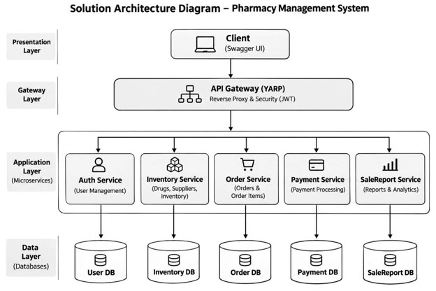
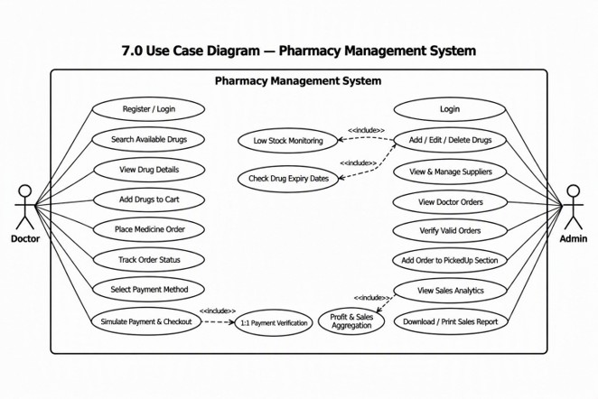
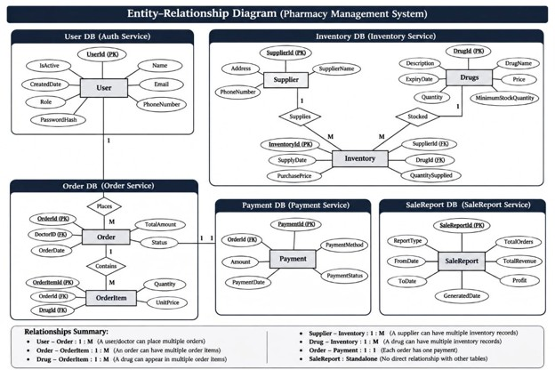
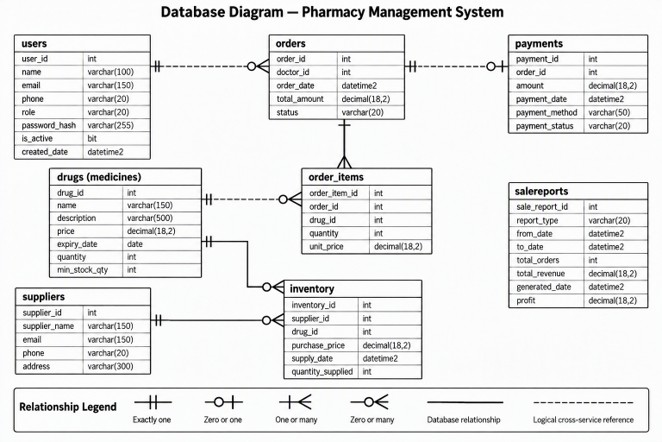
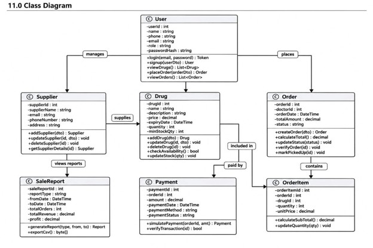

# Pharmacy Management System (Microservices POC) — Low Level Design (LLD)

**Project Name:** Pharmacy Management System  
**Architecture:** Microservices Architecture (5 Services + YARP API Gateway)  
**Date:** 19/11/2026  
**Current Document Version:** [1.0]  
**Author:** Lahari Chikoti  

---

## Document Approval
### Approvers of this document
| Name | Department | Role | Signature | Date |
|---|---|---|---|---|
| Lahari Chikoti | Engineering | Lead Architect / Author | *Approved* | 19/11/2026 |
| Technical Review Board | Architecture | Enterprise Review | *Approved* | 19/11/2026 |

### Document Change History
| Document Version # | Author | Date | Description |
|---|---|---|---|
| 1.0 | Lahari Chikoti | 19/11/2026 | Pharmacy Management System Final Low Level Design (LLD) |

---

## Table of Contents
| Section | Title |
|---|---|
| 1.0 | Document Purpose |
| 2.0 | Intended Audience |
| 3.0 | Project Background and Objectives |
| 4.0 | Requirements |
| 5.0 | Design Patterns |
| 6.0 | Architecture Diagram |
| 7.0 | Use Case Diagram |
| 8.0 | Entity-Relationship Diagram |
| 9.0 | Database Diagram |
| 10.0 | Class Diagram |
| 11.0 | Solution Steps |
| 12.0 | Classes Names |
| 13.0 | Validations |
| 14.0 | API Catalogue |
| 15.0 | HTTP Status Codes |
| 16.0 | Integrations |
| 17.0 | Sample API Requests |
| 18.0 | Sample API Responses |
| 19.0 | NUnit Unit Testing |

---

## 1.0 Document Purpose
This document describes the Low-Level Design (LLD) of the Pharmacy Management System. The system is built using C#, ASP.NET Core Web API, .NET 10 / .NET 8, and a microservices architecture. It defines the service layout, database tables, business rules, validations, APIs, and unit testing approach.

The application has five independent services: **Auth Service**, **Inventory Service**, **Order Service**, **Payment Service**, and **SaleReport Service**. Each service owns its private database. Services talk to each other through REST APIs, while the **YARP API Gateway** routes client requests. **Swagger UI** is used to test and document all endpoints, and **Entity Framework Core Code-First Migrations** manage all database schemas and evolutions.

---

## 2.0 Intended Audience
This document serves as a guide for project stakeholders:
- **Software Engineers & Developers**: Detailed class structure, DTO models, service layers, and API specifications.
- **System Architects**: Microservices decomposition, YARP gateway reverse-proxy topology, and inter-service HTTP communication patterns.
- **Database Administrators (DBAs)**: Entity-Relationship models, schemas, constraints, indices, and Code-First migration scripts.
- **Quality Assurance (QA) Engineers**: Acceptance criteria, validation boundary constraints, test catalogs, and NUnit test suites (TC-01 through TC-30).
- **Operations & DevOps Teams**: Service port registries, health diagnostics, Swagger dashboards, and database seed automation.

---

## 3.0 Project Background and Objectives

### 3.1 Project Background
Pharmacies need reliable software to manage medicine stocks, drug suppliers, doctor prescription orders, and sales accounting. Handling these records manually leads to misplaced orders, billing errors, or stock shortages. The Pharmacy Management System provides a clean backend solution. Doctors can check available medicines, add items to cart, and place orders. Admins can manage medicines, track supplier deliveries, verify orders, and view profit and sales reports.

### 3.2 Project Objective
The objective is to develop a reliable and modular backend using C#, ASP.NET Core Web API, .NET 10 / .NET 8, and microservices architecture. Key goals include:
- Dividing operations into five services with separate SQL databases.
- Managing schemas via Entity Framework Core Code-First Migrations.
- Securing endpoints using JWT Bearer authentication and role checks (Admin and Doctor).
- Enforcing that **Admin can only log in** (pre-seeded credentials: `admin@pharmacy.com` / `Admin@123`), while **Doctors can register and log in**.
- Enabling doctors to browse medicines, place orders, **cancel orders before payment with automated stock restoration**, and simulate payments.
- Enabling admins to manage inventory, verify orders, mark orders picked up, and review sales analytics.
- Documenting all endpoints in Swagger UI and validating logic with 30 NUnit tests.

---

## 4.0 Requirements

### 4.1 Functional Requirements (FR)
- **FR-01 (Pre-Seeded Admin Login)**: System pre-seeds administrator account (`admin@pharmacy.com` / `Admin@123`). Admin can only login; public registration of Admin accounts is strictly prohibited.
- **FR-02 (Doctor Registration & Login)**: Doctors can register with Name, Contact, Email, Password, and Role (`Doctor`), and log in to receive a signed JWT token.
- **FR-03 (Medicine Catalog Management)**: Admin can add, update, delete, search, and view medicines with pricing and minimum stock thresholds (default 20 units).
- **FR-04 (Supplier & Inward Stock Management)**: Admin can register suppliers and record inward inventory batches.
- **FR-05 (Doctor Shopping Cart & Order Placement)**: Doctors can stage medicines into an active cart, place orders, and have stock deducted atomically.
- **FR-06 (Order Cancellation Before Payment)**: Doctors can cancel any `Pending` or `Cart` order before payment is completed. Cancelling automatically restores the deducted stock back to inventory via `PUT /api/drugs/restore-stock`.
- **FR-07 (Payment Simulation with Order Guard)**: Doctors can simulate payments (Credit Card, Debit Card, UPI, Net Banking, Cash). Cancelled orders cannot be paid.
- **FR-08 (Order Verification & Pickup)**: Admin verifies paid orders (`Verified`) and marks them as `PickedUp` upon medication handover.
- **FR-09 (Sales & Profit Reporting)**: Admin generates Daily, Weekly, Monthly, and Yearly sales reports, profit analysis, top-selling medicines, and CSV export.

### 4.2 Non-Functional Requirements (NFR)
- **NFR-01 (Security)**: JWT Bearer authentication with HMAC-SHA256 tokens and BCrypt password hashing.
- **NFR-02 (Modularity & Loose Coupling)**: 5 microservices communicating via REST APIs; each service maintains its own isolated database.
- **NFR-03 (Maintainability & Database Migrations)**: Entity Framework Core Code-First Migrations automatically manage database schemas on startup.
- **NFR-04 (Testability)**: Comprehensive NUnit 3 test suite covering 30 test scenarios with mocked dependencies and in-memory DbContexts.
- **NFR-05 (Observability)**: Interactive Swagger UI on all microservices and unified routing on the YARP API Gateway.

### 4.3 Technology Stack
- **Programming Language**: C# 12 / 13
- **Framework**: ASP.NET Core Web API (.NET 10 / .NET 8)
- **ORM / Migrations**: Entity Framework Core 8 / 9 Code-First with Migrations
- **Database Engine**: Microsoft SQL Server 2022
- **API Gateway**: YARP (Yet Another Reverse Proxy)
- **Authentication**: JWT Bearer Tokens (Microsoft.AspNetCore.Authentication.JwtBearer)
- **API Documentation**: Swashbuckle.AspNetCore (Swagger / OpenAPI UI)
- **Testing**: NUnit 3, Moq, Microsoft.EntityFrameworkCore.InMemory

---

## 5.0 Design Patterns
- **Database-per-Service**: Each microservice maintains complete sovereignty over its private database (`Pharmacy_UserDB`, `Pharmacy_InventoryDB`, `Pharmacy_OrderDB`, `Pharmacy_PaymentDB`, `Pharmacy_SaleReportDB`).
- **API Gateway Pattern**: YARP provides unified routing on port 5000, insulating client applications from internal service ports.
- **Controller-Service-Repository (MVC)**: Clear separation of concerns across API Controllers, Service Business Logic, and EF Core Repositories.
- **Code-First Migrations**: Schema definition in C# entity classes with automated migrations.
- **Payment Gateway Simulation Pattern**: Native payment simulator mimicking real-world payment flows with 1:1 transaction integrity.

---

## 6.0 Architecture Diagram



### Description
The solution architecture diagram shows how the different parts of the Pharmacy Management System work together. Users access the system through client applications and Swagger UI for API testing. All requests pass through the API Gateway, which routes them to the appropriate microservice and ensures that only authenticated users can access secured endpoints. The system consists of five microservices: Auth Service for user authentication, Inventory Service for managing medicines and suppliers, Order Service for cart and order management, Payment Service for payment simulation, and SalesReport Service for generating reports and profit analysis. Each microservice has its own dedicated SQL Server database and communicates with other services through APIs instead of direct database connections. This architecture keeps the system modular, scalable, and easy to maintain.

---

## 7.0 Use Case Diagram



### Description
The use case diagram shows how the two main users, Admin and Doctor, interact with the Pharmacy Management System. The Doctor user can register and log in securely whereas the Admin User can login securely. Doctors can view available medicines, add medicines to a cart, place orders, perform payment simulation, track order status, view order history, and cancel orders before payment. Admins manage medicines, suppliers, and inventory records. They can verify orders, mark orders as picked up, monitor low-stock and expired medicines, analyze profits, view top-selling drugs, and generate downloadable or printable sales reports. Overall, the diagram illustrates the complete workflow from ordering medicines to inventory management and business reporting.

---

## 8.0 Entity-Relationship Diagram



### Description
The Entity Relationship (ER) Diagram shows how the Pharmacy Management System stores and connects data across different microservices. The User Database stores user information for Admins and Doctors. The Inventory Database manages drugs, suppliers, and inventory records. The Order Database stores orders and the medicines included in each order. The Payment Database stores payment simulation details, while the Sales Report Database stores generated sales reports. Relationships are maintained within the same database, such as Supplier-Inventory and Order-OrderItem. Since each microservice has its own database, cross-service relationships are handled through identifiers like UserId, DrugId, and OrderId and validated through API communication rather than direct database joins. This ensures service independence, scalability, and easier maintenance.

---

## 9.0 Database Diagram



### Description
The database diagram shows how data is stored across the five databases used in the Pharmacy Management System. The User Database stores user information such as login details, contact information, and roles. The Inventory Database manages medicines, suppliers, stock quantities, purchase prices, and inventory records. The Order Database stores orders placed by doctors along with the medicines included in each order. The Payment Database maintains payment simulation records for orders, while the Sales Report Database stores generated sales reports, revenue details, and profit summaries. Each database is owned by its respective microservice, and services communicate with one another through APIs instead of direct database connections. This approach keeps the system organized, scalable, and easy to maintain.

---

## 10.0 Class Diagram



### Description
The class diagram shows the main entities in the Pharmacy Management System and how they work together. The User class manages registration, login, and user roles. The Drug, Supplier, and Inventory classes handle medicine and stock management. The Order and OrderItem classes manage carts, orders, and order status updates. The Payment class stores payment simulation details, while the SalesReport class generates sales, revenue, and profit reports. Together, these classes support the complete workflow from managing medicines and placing orders to processing payments and generating reports.

---

## 11.0 Solution Steps

### 11.1 User Registration and Login
Users can create an account by providing their name, contact number, email address, password, and role (Doctor) and the Admin can login. Once registered, the doctor can log in using their email and password. After successful authentication, the system generates a secure token that allows users to access protected features based on their role.

### 11.2 Admin Manages Drugs and Suppliers
After logging in, the Admin can manage medicines, suppliers, and inventory records. The Admin can add new medicines, update existing medicine details, remove discontinued medicines, register suppliers, and record incoming stock. The system automatically updates stock quantities and helps monitor inventory levels.

### 11.3 Doctor Views Drugs and Adds to Cart
The Doctor can browse available medicines, view details such as price, stock availability, and expiry date, and select the medicines required. Selected medicines can be added to a cart before proceeding to checkout. The system calculates the order amount based on the selected medicines and quantities.

### 11.4 Doctor Places Order and Simulates Payment
When the Doctor confirms the cart, the order is created and moved to the Pending status. The system checks stock availability and updates inventory accordingly. The Doctor then completes a payment simulation by selecting a payment method such as UPI, Card, Net Banking, or Cash. Payment details are stored in the system for order processing and testing purposes.

### 11.5 Order Cancellation Before Payment & Stock Restoration
If the Doctor decides not to proceed with an order before payment is completed, they can cancel the order. The order status updates to Cancelled, and the system automatically restores the deducted stock quantities back to the active drug inventory so medications are not locked or depleted erroneously.

### 11.6 Admin Verifies Order and Marks Picked Up
The Admin reviews orders placed by doctors and verifies their validity. Once verified, the order status is updated to Verified. After the medicines are handed over to the doctor or customer, the Admin marks the order as PickedUp, indicating successful order completion.

### 11.7 Admin Generates and Downloads Sales Reports
The Admin can generate sales reports for a selected period such as Daily, Weekly, Monthly, or Yearly. The system calculates total sales, revenue, and profit and displays the results in a report. Reports can also be downloaded or printed for record-keeping and analysis purposes.

---

## 12.0 Classes Names

### Entities (Models)
- `User`: Represents system users (`UserId`, `Name`, `Email`, `PhoneNumber`, `PasswordHash`, `Role`, `CreatedDate`, `IsActive`).
- `Drug`: Represents pharmaceutical drugs (`DrugId`, `DrugName`, `Description`, `Category`, `Price`, `ExpiryDate`, `Quantity`, `MinimumStockQuantity`, `IsAvailable`, `CreatedDate`, `UpdatedDate`).
- `Supplier`: Represents pharmaceutical distributors (`SupplierId`, `SupplierName`, `Email`, `PhoneNumber`, `Address`).
- `Inventory`: Represents inward stock batches (`InventoryId`, `SupplierId`, `DrugId`, `PurchasePrice`, `SupplyDate`, `QuantitySupplied`, `BatchNumber`, `Notes`).
- `Order`: Represents medication orders (`OrderId`, `DoctorID`, `OrderDate`, `TotalAmount`, `Status`).
- `OrderItem`: Represents line items inside an order (`OrderItemId`, `OrderId`, `DrugId`, `DrugName`, `Quantity`, `UnitPrice`).
- `Payment`: Represents payment simulation transactions (`PaymentId`, `OrderId`, `Amount`, `PaymentDate`, `PaymentMethod`, `PaymentStatus`, `TransactionReference`).
- `SaleReport`: Represents aggregate business sales data (`SaleReportId`, `ReportType`, `FromDate`, `ToDate`, `TotalOrders`, `TotalRevenue`, `Profit`, `GeneratedDate`).

### Controllers (API Layer)
- `AuthController`: User registration, pre-seeded admin login, and token generation.
- `DrugsController`: Medicine catalog CRUD, search, low-stock, and stock restoration.
- `SuppliersController`: Supplier registry CRUD.
- `InventoryController`: Inward batch recording.
- `OrdersController`: Cart staging, order placement, order cancellation, verification, and pickup.
- `PaymentsController`: Payment simulation and 1:1 receipt lookup.
- `SaleReportsController`: Report generation, profit analysis, top-selling analytics, and CSV download.

### Services (Business Logic)
- `IAuthService` / `AuthService`
- `IDrugService` / `DrugService`
- `ISupplierService` / `SupplierService`
- `IInventoryService` / `InventoryService`
- `IOrderService` / `OrderService`
- `IPaymentService` / `PaymentService`
- `ISaleReportService` / `SaleReportService`

### Repositories (Data Access Layer)
- `IUserRepository` / `UserRepository`
- `IDrugRepository` / `DrugRepository`
- `ISupplierRepository` / `SupplierRepository`
- `IInventoryRepository` / `InventoryRepository`
- `IOrderRepository` / `OrderRepository`
- `IPaymentRepository` / `PaymentRepository`
- `ISaleReportRepository` / `SaleReportRepository`

---

## 13.0 Validations
1. **Unique Email Validation**: Prevent registration using an email address that already exists in the system.
2. **Admin Registration Prevention**: Strictly disallow registration requests with role `Admin`. Admin accounts must be pre-seeded.
3. **Password Policy Validation**: Password must meet minimum length and complexity requirements.
4. **Medicine Price Validation**: Purchase Price and Selling Price must be greater than zero.
5. **Stock Quantity Validation**: Stock quantity cannot be negative during creation or updates.
6. **Supplier Validation**: A drug inward record can only be associated with an existing supplier.
7. **Inventory Inward Validation**: Inward stock quantity must be greater than zero.
8. **Order Quantity Validation**: Ordered quantity must be greater than zero and cannot exceed available stock.
9. **Order Existence Validation**: Payment, verification, pickup, and cancellation actions can only be performed on existing orders.
10. **Order Cancellation Validation**: Orders cannot be cancelled after they have been marked as PickedUp.
11. **Payment Amount Validation**: Payment amount must match the calculated order total.
12. **Payment Cancellation Protection**: Payments cannot be processed or simulated for cancelled orders.
13. **Date Range Validation**: Sales report start date must be earlier than or equal to the end date.
14. **Drug Availability Validation**: Orders can only include medicines that are active and available for sale.
15. **Duplicate Drug Validation**: Prevent creation of duplicate medicines with the same name and category combination.
16. **JWT Expiration Validation**: Expired JWT tokens must be rejected and require re-authentication.

---

## 14.0 API Catalogue

### 1. User DB (Auth Service — Port 5001 / Gateway `/api/auth`)
| Method | Endpoint | Allowed Roles | Description |
|---|---|---|---|
| `POST` | `/api/auth/register` | Public (Doctor only) | Self-registration for doctors. Admin registration is prohibited. |
| `POST` | `/api/auth/login` | Public | Authenticates credentials and returns a signed JWT Bearer token. |
| `GET` | `/api/auth/current-user` | Authenticated | Returns current authenticated user profile (`UserId`, `Email`, `Role`, `Name`). |

### 2. Inventory DB (Inventory Service — Port 5002 / Gateway `/api/drugs`, `/api/suppliers`, `/api/inventory`)
| Method | Endpoint | Allowed Roles | Description |
|---|---|---|---|
| `GET` | `/api/drugs` | Public / Doctor / Admin | List all active medications. |
| `GET` | `/api/drugs/{id}` | Public / Doctor / Admin | Get medication by ID. |
| `GET` | `/api/drugs/search` | Public / Doctor / Admin | Search drugs by name or category. |
| `GET` | `/api/drugs/low-stock` | Admin | Retrieve medicines below minimum stock threshold (`Quantity <= 20`). |
| `GET` | `/api/drugs/expired` | Admin | Retrieve medicines whose expiry date has passed. |
| `POST` | `/api/drugs` | Admin | Add a new drug with pricing and stock threshold. |
| `PUT` | `/api/drugs/{id}` | Admin | Update drug details. |
| `DELETE` | `/api/drugs/{id}` | Admin | Delete a drug record. |
| `PUT` | `/api/drugs/restore-stock` | Internal / OrderService | Restores drug stock quantities when an order is cancelled. |
| `GET` | `/api/suppliers` | Admin | List all registered suppliers. |
| `GET` | `/api/suppliers/{id}` | Admin | Get supplier details by ID. |
| `POST` | `/api/suppliers` | Admin | Register a new supplier. |
| `PUT` | `/api/suppliers/{id}` | Admin | Update supplier contact info. |
| `DELETE` | `/api/suppliers/{id}` | Admin | Delete a supplier. |
| `POST` | `/api/inventory` | Admin | Record incoming inventory stock batch from supplier. |

### 3. Order DB (Order Service — Port 5003 / Gateway `/api/orders`)
| Method | Endpoint | Allowed Roles | Description |
|---|---|---|---|
| `GET` | `/api/orders` | Admin | View all orders placed across all doctors. |
| `GET` | `/api/orders/{id}` | Authenticated | View details of a specific order. |
| `GET` | `/api/orders/my-orders` | Doctor | View order history for the authenticated doctor. |
| `GET` | `/api/orders/cart` | Doctor | Retrieve current active cart items for the logged-in doctor. |
| `POST` | `/api/orders/cart` | Doctor | Add drug items to cart. |
| `POST` | `/api/orders` | Doctor | Place order, deduct stock from Inventory, and move to `Pending`. |
| `PUT` | `/api/orders/{id}/cancel` | Doctor / Admin | Cancel order before payment. Automatically restores stock to inventory. |
| `GET` | `/api/orders/{id}/validate` | Admin | Validate order items, pricing, and stock feasibility. |
| `PUT` | `/api/orders/{id}/verify` | Admin | Verify order status after successful payment (`Status = Verified`). |
| `PUT` | `/api/orders/{id}/pickup` | Admin | Mark order as `PickedUp` upon physical handover of medicines. |
| `GET` | `/api/orders/picked-up` | Admin | List all completed picked-up orders. |

### 4. Payment DB (Payment Service — Port 5004 / Gateway `/api/payments`)
| Method | Endpoint | Allowed Roles | Description |
|---|---|---|---|
| `POST` | `/api/payments/simulate` | Doctor | Simulates payment. Checks order exists, is not cancelled, and amount matches. |
| `GET` | `/api/payments/{id}` | Admin / Doctor | View payment receipt and transaction reference. |
| `GET` | `/api/payments/order/{orderId}` | Admin / Doctor | Retrieve payment record by associated Order ID (1:1). |

### 5. SaleReport DB (SaleReport Service — Port 5005 / Gateway `/api/salereports`)
| Method | Endpoint | Allowed Roles | Description |
|---|---|---|---|
| `GET` | `/api/salereports` | Admin | List all generated sales reports. |
| `GET` | `/api/salereports/{id}` | Admin | Retrieve sales report by ID. |
| `POST` | `/api/salereports/generate` | Admin | Generate a new Daily, Weekly, Monthly, or Yearly sales report. |
| `GET` | `/api/salereports/{id}/download` | Admin | Export and download sales report as CSV spreadsheet. |
| `GET` | `/api/salereports/{id}/print` | Admin | Retrieve formatted printable receipt view. |
| `GET` | `/api/salereports/analytics/profit` | Admin | View profit analysis (`SellingPrice - PurchasePrice`). |
| `GET` | `/api/salereports/analytics/top-selling` | Admin | View highest selling drugs by total quantity sold. |
| `GET` | `/api/salereports/analytics/dashboard` | Admin | High-level business KPI dashboard (Revenue, Orders, Profit). |

---

## 15.0 HTTP Status Codes
- `200 OK`: Request succeeded.
- `201 Created`: Resource successfully created.
- `400 Bad Request`: Validation failure (e.g. attempting Admin registration, negative quantity, cancelled order payment).
- `401 Unauthorized`: Missing or invalid JWT Bearer token.
- `403 Forbidden`: Authenticated user lacks the required role (`Admin` or `Doctor`).
- `404 Not Found`: Target resource does not exist.
- `409 Conflict`: Business state conflict (e.g. duplicate email, duplicate payment).
- `500 Internal Server Error`: Unhandled server exception.

---

## 16.0 Integrations
- **YARP API Gateway**: Central entry point and routes client requests to microservices on port 5000.
- **REST APIs**: Inter-service HTTP communication via `HttpClient` (OrderService -> InventoryService stock deduction & restoration; PaymentService -> OrderService status verification).
- **JWT Bearer Authentication**: Secures APIs with signed tokens and supports role-based access for Admin and Doctor.
- **SQL Server 2022**: Maintains 5 separate databases ensuring data isolation per service.
- **Entity Framework Core Migrations**: Manages database schema versioning, Code-First mappings, and automated startup migrations.
- **Swagger UI**: Provides interactive API documentation and testing for all microservices.
- **NUnit 3 Test Framework**: Automated test suite executing 30 test cases covering all business logic and edge cases.

---

## 17.0 Sample API Requests

### Sample POST Request to Create an Order (`POST /api/orders`)
```json
{
  "items": [
    {
      "drugId": 1,
      "drugName": "Amoxicillin 500mg",
      "quantity": 10,
      "unitPrice": 25.00
    },
    {
      "drugId": 2,
      "drugName": "Paracetamol 650mg",
      "quantity": 5,
      "unitPrice": 5.00
    }
  ]
}
```

### Sample POST Request to Simulate Payment (`POST /api/payments/simulate`)
```json
{
  "orderId": 1,
  "amount": 275.00,
  "paymentMethod": "UPI"
}
```

### Sample PUT Request to Cancel Order Before Payment (`PUT /api/orders/1/cancel`)
*No request body required. Uses authenticated doctor credentials from JWT.*

---

## 18.0 Sample API Responses

### Successful Response after Order Creation (`201 Created`)
```json
{
  "orderId": 1,
  "doctorID": 2,
  "orderDate": "2026-11-21T10:30:00Z",
  "totalAmount": 275.00,
  "status": "Pending",
  "items": [
    {
      "orderItemId": 1,
      "orderId": 1,
      "drugId": 1,
      "drugName": "Amoxicillin 500mg",
      "quantity": 10,
      "unitPrice": 25.00
    },
    {
      "orderItemId": 2,
      "orderId": 1,
      "drugId": 2,
      "drugName": "Paracetamol 650mg",
      "quantity": 5,
      "unitPrice": 5.00
    }
  ]
}
```

### Successful Response after Order Cancellation (`200 OK`)
```json
{
  "orderId": 1,
  "status": "Cancelled",
  "message": "Order 1 has been cancelled and stock has been restored to inventory."
}
```

### Error Response when Attempting Payment on Cancelled Order (`400 Bad Request`)
```json
{
  "success": false,
  "message": "Cannot process payment for a cancelled order."
}
```

---

## 19.0 NUnit Unit Testing
The unit testing suite validates key business logic, constraints, and error scenarios using NUnit 3:

| Test ID | Microservice | Test Scenario | Expected Outcome |
|---|---|---|---|
| `TC-01` | AuthService | Register Doctor with valid data | User created successfully with Doctor role |
| `TC-02` | AuthService | Register with already registered email | Returns failure indicating duplicate email |
| `TC-03` | AuthService | Login with correct credentials | Returns JWT token and success status |
| `TC-04` | AuthService | Login with invalid password | Returns failure indicating invalid credentials |
| `TC-05` | InventoryService | Add new drug with positive stock and price | Drug successfully added to database |
| `TC-06` | InventoryService | Query low stock drugs | Returns drugs with `Quantity <= 20` |
| `TC-07` | InventoryService | Query expired drugs | Returns drugs where `ExpiryDate < DateTime.UtcNow` |
| `TC-08` | InventoryService | Register new supplier | Supplier created successfully |
| `TC-09` | InventoryService | Add inward inventory batch | Drug quantity increases by supplied quantity |
| `TC-10` | OrderService | Add drugs to cart | Order created with `Status = "Cart"` |
| `TC-11` | OrderService | Place order with available stock | Order created with `Status = "Pending"`, stock deducted |
| `TC-12` | OrderService | Admin verifies valid order | Order status transitions to `Verified` |
| `TC-13` | OrderService | Admin marks verified order as picked up | Order status transitions to `PickedUp` |
| `TC-14` | OrderService | Place order when stock is insufficient | Returns failure, order not created |
| `TC-15` | PaymentService | Simulate payment with matching amount | Payment marked `Completed`, Order marked `Verified` |
| `TC-16` | PaymentService | Simulate payment with mismatched amount | Returns failure, payment not processed |
| `TC-17` | PaymentService | Duplicate payment on already paid order | Returns failure, prevents double payment |
| `TC-18` | PaymentService | Payment on non-existent order | Returns failure indicating order not found |
| `TC-19` | SaleReportService | Generate monthly sales report | Correctly aggregates total orders and revenue |
| `TC-20` | SaleReportService | Calculate profit margin | Profit equals `TotalRevenue - TotalPurchaseCost` |
| `TC-21` | SaleReportService | Top selling drugs report | Correctly sorts drugs by quantity sold descending |
| `TC-22` | SaleReportService | Download sales report as CSV | Returns non-empty CSV formatted byte array |
| `TC-23` | AuthService | Pre-seeded admin and doctor credentials exist | Seeded users exist in database |
| `TC-24` | InventoryService | Search drugs by name keyword | Returns matching active medications |
| `TC-25` | InventoryService | Get drug by non-existent ID | Returns null / not found |
| `TC-26` | OrderService | **Cancel order before payment** | Status set to `Cancelled`, stock restored to inventory |
| `TC-27` | OrderService | Cancel picked-up order | Rejection: picked-up orders cannot be cancelled |
| `TC-28` | InventoryService | **Stock restoration on cancellation** | Drug quantity restored by cancelled quantity |
| `TC-29` | AuthService | **Prevent Admin registration** | Rejection: Admin registration is strictly prohibited |
| `TC-30` | PaymentService | **Reject payment on cancelled order** | Rejection: Cannot process payment for cancelled order |
