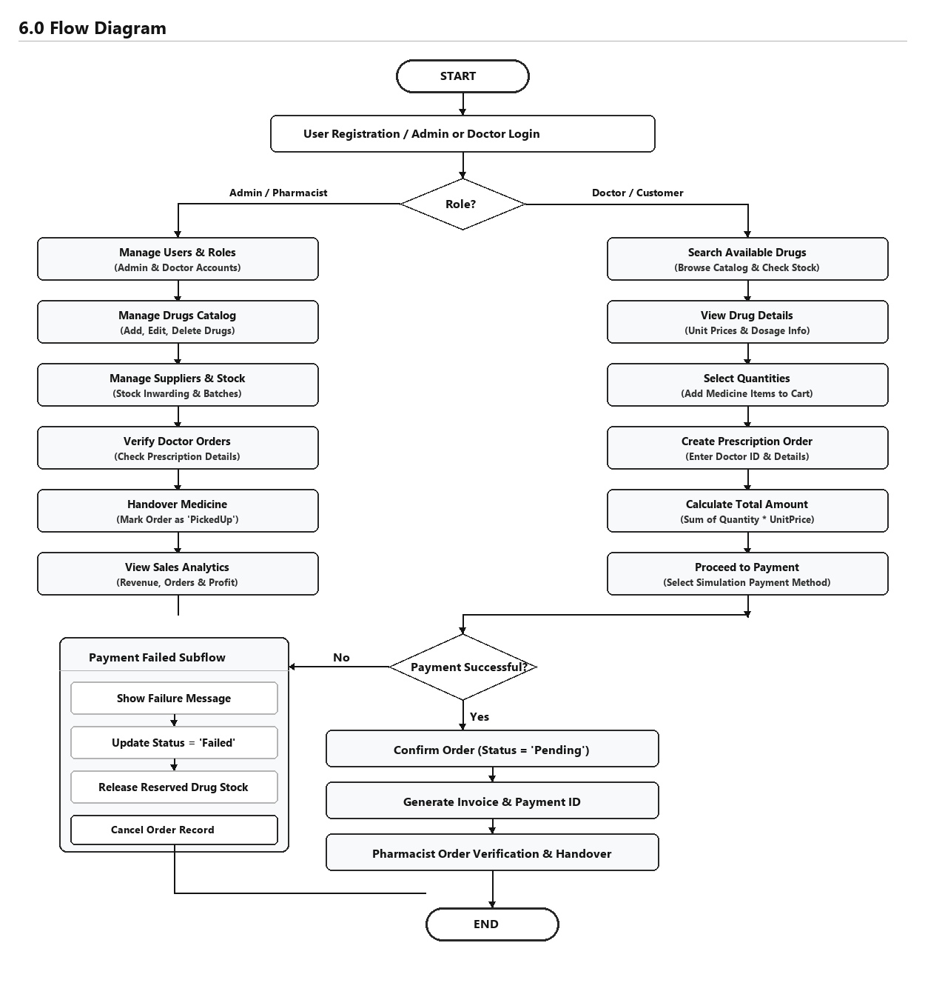
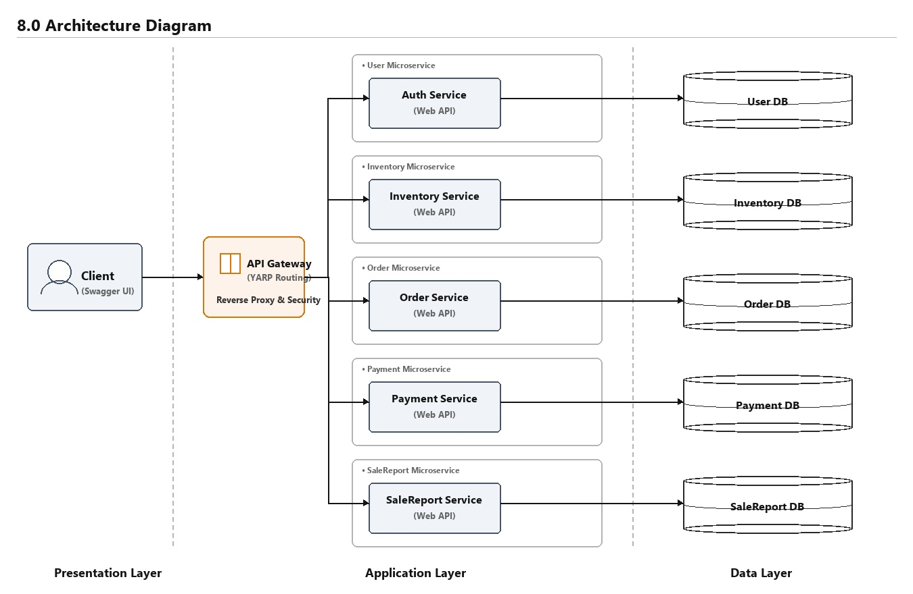
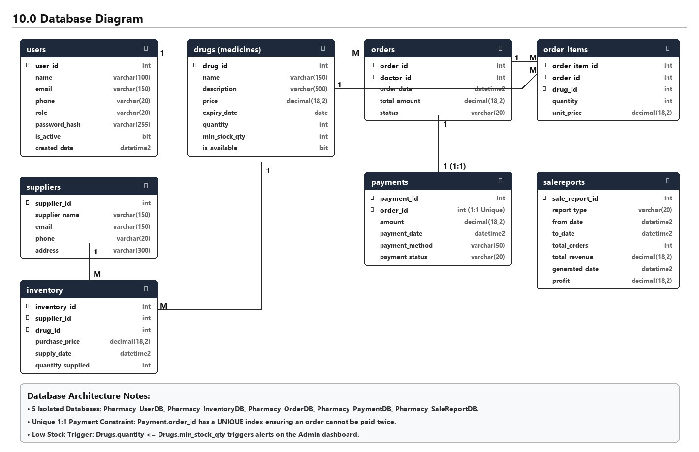

# Pharmacy Management System — Low Level Design (LLD)

**Project Name:** Pharmacy Management System  
**Architecture:** Microservices Architecture (5 Services)  
**Version:** 1.0  
**Date:** 19/11/2026  
**Author:** Lahari Chikoti  

---

## Table of Contents
- 1.0 Document Purpose
- 2.0 Intended Audience
- 3.0 Project Background and Objectives
  - 3.1 Project Background
  - 3.2 Project Objective
- 4.0 Requirements
  - 4.1 Functional Requirements (FR)
  - 4.2 Non-Functional Requirements
  - 4.3 Technology Stack
- 5.0 Design Patterns
- 6.0 Flow Diagram
- 7.0 Use Case Diagram
- 8.0 Architecture Diagram
- 9.0 Entity-Relationship Diagram
- 10.0 Database Diagram
- 11.0 Class Diagram
- 12.0 Solution Steps
- 13.0 Classes Names
- 14.0 Validations
- 15.0 API Catalogue
- 16.0 HTTP Status Codes
- 17.0 Integrations
- 18.0 Sample API Requests
- 19.0 Sample API Responses
- 20.0 NUnit Unit Testing

---

## 1.0 Document Purpose
This document describes the Low-Level Design (LLD) of the Pharmacy Management System. The system is built using C#, ASP.NET Core Web API, .NET 10, and a microservices architecture. It defines the service layout, database tables, business rules, validations, APIs, and unit testing approach.

The application has five independent services: Auth Service, Inventory Service, Order Service, Payment Service, and SaleReport Service. Each service owns its private database. Services talk to each other through REST APIs, while the YARP API Gateway routes client requests. Swagger UI is used to test and document all endpoints.

---

## 2.0 Intended Audience
| Role | Engagement in Pharmacy Management Architecture |
|---|---|
| **Product Owners / SMEs** | Confirm that the design covers all pharmacy requirements. |
| **Business Analysts** | Map doctor and admin business workflows to technical APIs. |
| **Enterprise Architects** | Review microservice boundaries, security rules, and database isolation. |
| **Solution Architects** | Check the API contracts, service communications, and data flow. |
| **Developers & QA Engineers** | Use this document to implement features and write unit tests. |

---

## 3.0 Project Background and Objectives

### 3.1 Project Background
Pharmacies need reliable software to manage medicine stocks, drug suppliers, doctor prescription orders, and sales accounting. Handling these records manually leads to misplaced orders, billing errors, or stock shortages.

The Pharmacy Management System provides a clean backend solution. Doctors can check available medicines, add items to cart, and place orders. Admins can manage medicines, track supplier deliveries, verify orders, and view profit and sales reports.

### 3.2 Project Objective
The objective is to develop a reliable and modular backend using C#, ASP.NET Core Web API, .NET 10, and microservices architecture. Key goals include:
- Dividing operations into five services with separate SQL databases.
- Securing endpoints using JWT Bearer authentication and role checks (Admin and Doctor).
- Enabling doctors to browse medicines, place orders, and simulate payments.
- Enabling admins to manage inventory, verify orders, and review sales analytics.
- Documenting all endpoints in Swagger UI and validating logic with NUnit tests.

---

## 4.0 Requirements

### 4.1 Functional Requirements (FR)
**For Admin:**
- **Login / Signup:** Sign up and log in using name, email, contact number, and password.
- **View Drugs:** Browse and view full details of all medicines in the pharmacy.
- **Manage Drugs:** Add new drugs, edit drug details and prices, and delete drugs.
- **Manage Suppliers:** View suppliers, add new suppliers, and update supplier information.
- **View Doctor Orders:** Review orders placed by doctors and check their validity.
- **Verify Orders:** Mark valid doctor orders as 'Verified'.
- **Order Handover:** Move verified orders to the 'PickedUp' section once collected.
- **Sales Reports:** View daily, weekly, monthly, and yearly sales summaries.
- **Download / Print:** Export sales reports in CSV format for printing and bookkeeping.
- **Dashboard Analytics:** Monitor low stock medicines, check expired drugs, analyze profit margins, and track top-selling medicines.

**For Doctor User:**
- **Login / Signup:** Sign up and log in with name, email, contact number, and password.
- **View Drugs:** Browse all available medicines with prices and current stock counts.
- **Buy Drugs & Cart:** Add selected drugs to cart and create prescription orders.
- **Payment Simulation:** Complete order payment checkout using simulated payment.
- **Track Order Status:** Check order progress (Cart, Pending, Verified, PickedUp, or Cancelled).
- **Order History:** View all previously placed orders and receipts.

### 4.2 Non-Functional Requirements
- **Microservices Architecture:** 5 separate services with isolated databases.
- **Security:** Protected APIs require valid JWT Bearer tokens with role claims.
- **REST APIs:** Synchronous communication between services using typed HTTP clients.
- **Routing:** YARP API Gateway acts as a single entry point for all client requests.
- **Validation & Error Handling:** Clear validation messages and standard HTTP status codes.
- **Testing:** Comprehensive NUnit unit tests and interactive testing via Swagger UI.

### 4.3 Technology Stack
| Category | Technology | Purpose |
|---|---|---|
| **Language** | C# 12 | Primary programming language for all services. |
| **Framework** | ASP.NET Core Web API | Framework used to build RESTful microservice APIs. |
| **Runtime** | .NET 10 | Cross-platform runtime to build and run the services. |
| **ORM** | Entity Framework Core 8 | Maps C# models to SQL tables using Code-First approach. |
| **Database** | Microsoft SQL Server 2022 | Hosts 5 separate databases for microservice data isolation. |
| **Security** | JWT Bearer & PBKDF2 | Authenticates users and hashes passwords securely. |
| **Authorization** | Role-Based Access (RBAC) | Restricts API access based on Admin and Doctor roles. |
| **API Gateway** | YARP | Routes incoming requests to the appropriate microservices. |
| **API Documentation** | Swagger / OpenAPI 3.0 | Documents and interactively tests backend APIs. |
| **Testing** | NUnit & Moq | Automated unit test suite verifying service layer logic. |

---

## 5.0 Design Patterns
| Name | Description |
|---|---|
| **REST API** | HTTP-based REST APIs are used for client calls and service-to-service communication. |
| **Microservices Architecture** | The system is divided into five independent services: Auth, Inventory, Order, Payment, and SaleReport. |
| **Layered Architecture** | Each microservice follows a Controller, Service, and Repository structure to separate concerns. |
| **Repository Pattern** | Repositories handle database access, keeping data logic separate from business rules. |
| **Dependency Injection** | Services and repositories are injected via built-in DI containers for testability. |
| **Database per Service** | Each microservice owns its private database. No direct cross-service SQL joins are allowed. |
| **API Gateway Pattern** | YARP provides a centralized entry point and routes client requests to microservices. |
| **DTO Pattern** | Request and response DTOs define clean API contracts and prevent over-posting. |

---

## 6.0 Flow Diagram


### Description
The flow diagram shows the operational steps for Admin and Doctor users. A user signs up or logs in and receives a JWT token. Based on their role:
- Admins manage drugs, update supplier inventory, review doctor orders, verify orders, mark orders as picked up, and review sales reports.
- Doctors browse available medicines, add items to cart, place orders, and proceed to payment simulation.
If payment succeeds, the order is placed in Pending status for admin verification. If payment fails, the system shows an error and releases any reserved medicine stock.

---

## 7.0 Use Case Diagram


### Description
The use case diagram highlights the interactions between the two primary actors (Doctor and Admin) and the Pharmacy Management System.
The Doctor registers, logs in, browses medicines, places prescription orders, simulates payments, and tracks order status.
The Admin manages the drug catalog, handles supplier stock inwarding, verifies incoming doctor orders, marks completed orders as picked up, and views financial reports. User registration and login are shared by both roles.

---

## 8.0 Architecture Diagram


### Description
The architecture diagram represents the layered structure of the system:
1. **Presentation Layer:** Client applications and Swagger UI submit HTTP requests.
2. **Application Layer:** The YARP API Gateway routes incoming requests to five microservices: Auth Service, Inventory Service, Order Service, Payment Service, and SaleReport Service.
3. **Data Layer:** Each microservice manages its own private SQL database (User DB, Inventory DB, Order DB, Payment DB, SaleReport DB). Services communicate using REST APIs.

---

## 9.0 Entity-Relationship Diagram


### Description
The ER diagram represents the data entities and attributes organized into separate boxes for each database:
- **User DB:** Contains the User entity with login, role, and contact attributes.
- **Inventory DB:** Contains Drugs, Suppliers, and Inventory entities with supply and stock relationships.
- **Order DB:** Contains Orders and OrderItems entities tracking prescription orders.
- **Payment DB:** Contains Payments tracking simulated checkout transactions.
- **SaleReport DB:** Standalone service containing SaleReports for revenue and profit summaries.
Physical foreign keys exist only within the same database. Relationships across databases are logical references verified through REST APIs.

---

## 10.0 Database Diagram


### Description
The database diagram illustrates the physical tables, column data types, and primary/foreign keys across all five databases.
Key tables include Users (credentials and roles), Drugs (pricing, quantities, and minimum stock alerts), Suppliers (vendor contacts), Inventory (purchase price and supply dates), Orders and OrderItems (prescription line items), Payments (1:1 unique payment records), and SaleReports (financial totals).
A unique index on Payment.OrderId prevents duplicate payments for the same order.

---

## 11.0 Class Diagram


### Description
The class diagram illustrates the object-oriented domain models and their responsibilities:
- **User:** Handles authentication, signup, and role identification.
- **Drug:** Represents medicine catalog data, selling price, stock levels, and expiry date.
- **Supplier:** Manages supplier profiles and vendor associations.
- **Order & OrderItem:** Tracks prescription lines, quantities, unit prices, and status updates.
- **Payment:** Simulates checkout transactions with 1:1 order enforcement.
- **SaleReport:** Aggregates revenue, purchase costs, and profit calculations.
Dashed lines indicate relationships such as 'places', 'manages', 'supplies', 'contains', and 'paid by'.

---

## 12.0 Solution Steps

### 12.1 User Registration and Login
- The user submits registration information (name, email, phone number, password, and role).
- Auth Service hashes the password securely using PBKDF2 and saves the user record in User DB.
- The user logs in with valid email and password credentials.
- Auth Service verifies the password hash and returns a signed JWT token containing user ID, email, and role.

### 12.2 Admin Manages Drugs and Suppliers
- The Admin logs in and sends the JWT token in the Authorization header.
- The Admin creates, updates, or deletes medicines in the Inventory Service, setting selling price and minimum stock quantity.
- The Admin adds suppliers and enters incoming medicine stock along with purchase price in the Inventory table.
- Medicine catalog and stock data are saved in Inventory DB.

### 12.3 Doctor Searches Drugs and Adds to Cart
- The Doctor logs in and queries available medicines through the search endpoints.
- Inventory Service returns active medicines that have sufficient stock.
- The Doctor selects medicine items, specifies quantities, and adds them to the order cart.

### 12.4 Doctor Places Order and Simulates Payment
- The Doctor submits the order payload containing selected medicine items and quantities.
- Order Service calls Inventory Service to verify availability and deduct medicine quantities.
- Order Service creates the order record in Order DB with status 'Pending' and triggers payment.
- Payment Service records the simulated transaction, assigns a unique transaction reference, and sets status to 'Completed'.

### 12.5 Admin Verifies Order and Marks PickedUp
- The Admin reviews pending orders submitted by doctors.
- The Admin verifies prescription items and updates order status to 'Verified'.
- When the medicines are collected, the Admin updates the status to 'PickedUp' in the pickup section.

### 12.6 Admin Generates and Downloads Sales Reports
- The Admin selects a reporting range (Daily, Weekly, Monthly, or Yearly).
- SaleReport Service aggregates completed orders, calculates revenue, subtracts purchase costs to compute profit, and saves the report.
- The Admin can view summary statistics or download the report as a CSV file.

---

## 13.0 Classes Names

### Entities (Models)
| S.No | Class Name | Description |
|---|---|---|
| 1 | `User.cs` | Represents user account information, password hash, and assigned role (Admin or Doctor). |
| 2 | `Drug.cs` | Represents medicine details, description, selling price, expiry date, quantity, and minimum stock limit. |
| 3 | `Supplier.cs` | Represents supplier contact information, email, phone number, and address. |
| 4 | `Inventory.cs` | Represents incoming stock shipments, purchase prices, supply dates, and supplier links. |
| 5 | `Order.cs` | Represents prescription orders placed by doctors, order date, total amount, and status. |
| 6 | `OrderItem.cs` | Represents individual medicine line items belonging to an order with unit price. |
| 7 | `Payment.cs` | Represents simulated payment records with 1:1 order linking and transaction references. |
| 8 | `SaleReport.cs` | Represents financial sales reports, total order counts, revenue, and profit calculations. |

### Controllers (API Layer)
| S.No | Class Name | Description |
|---|---|---|
| 1 | `AuthController.cs` | Handles user registration, login, and profile retrieval APIs. |
| 2 | `DrugsController.cs` | Handles drug catalog search, drug creation, updates, and low-stock alerts. |
| 3 | `SuppliersController.cs` | Handles supplier registration, retrieval, and profile updates. |
| 4 | `InventoryController.cs` | Handles stock inward shipments, batch updates, and stock deduction. |
| 5 | `OrdersController.cs` | Handles order creation, status tracking, admin verification, and pickup handover. |
| 6 | `PaymentsController.cs` | Handles checkout payment simulation and transaction verification. |
| 7 | `SaleReportsController.cs` | Handles sales report generation, profit analytics, and CSV download APIs. |

### Services (Business Logic)
| S.No | Class Name | Description |
|---|---|---|
| 1 | `AuthService.cs` | Implements user registration, password verification, and login logic. |
| 2 | `TokenService.cs` | Generates signed JWT tokens with user claims and expiration. |
| 3 | `DrugService.cs` | Handles medicine availability checks, stock updates, and low-stock alerts. |
| 4 | `SupplierService.cs` | Manages supplier records, contact updates, and vendor associations. |
| 5 | `OrderService.cs` | Coordinates order creation, stock reservation, verification, and handover. |
| 6 | `PaymentService.cs` | Simulates payment processing and enforces 1:1 transaction rules. |
| 7 | `SaleReportService.cs` | Computes revenue, purchase costs, profit, and builds CSV report files. |

### Repositories (Data Access Layer)
| S.No | Class Name | Description |
|---|---|---|
| 1 | `UserRepository.cs` | Manages database operations for user accounts in User DB. |
| 2 | `DrugRepository.cs` | Handles CRUD database queries for medicines in Inventory DB. |
| 3 | `SupplierRepository.cs` | Manages database queries for supplier records in Inventory DB. |
| 4 | `InventoryRepository.cs` | Manages stock inward entries and batch history in Inventory DB. |
| 5 | `OrderRepository.cs` | Handles order and order item queries with EF Core in Order DB. |
| 6 | `PaymentRepository.cs` | Saves and queries payment records with unique order IDs in Payment DB. |
| 7 | `SaleReportRepository.cs` | Stores and queries sales summary records in SaleReport DB. |

---

## 14.0 Validations
- **User Input Validations:** Ensure required fields (name, valid email format, contact phone number, password length) are provided.
- **Role Authorization:** Ensure only Admin can add/edit drugs, manage suppliers, verify orders, and view sales reports.
- **Doctor Isolation:** Ensure Doctors can only view and manage their own orders.
- **Stock Availability:** Verify that requested medicine quantities do not exceed available stock before creating an order.
- **Low Stock Trigger:** Automatically identify medicines whose stock is at or below MinimumStockQuantity.
- **Expiry Validation:** Prevent selling medicines that have passed their expiration date.
- **Order Status Flow:** Orders progress through Cart -> Pending -> Verified -> PickedUp (or Cancelled).
- **1:1 Payment Rule:** Exactly one payment is allowed per order. Duplicate payments for the same order are rejected.
- **Token Security:** Every protected API validates JWT signature, issuer, expiration, and role claims.

---

## 15.0 API Catalogue
| Module | Endpoint | Method | Access |
|---|---|---|---|
| Auth | `/api/auth/register` | POST | Public |
| Auth | `/api/auth/login` | POST | Public |
| Auth | `/api/auth/me` | GET | Admin / Doctor |
| Inventory | `/api/drugs` | GET | Admin / Doctor |
| Inventory | `/api/drugs/{id}` | GET | Admin / Doctor |
| Inventory | `/api/drugs` | POST | Admin |
| Inventory | `/api/drugs/{id}` | PUT | Admin |
| Inventory | `/api/drugs/{id}` | DELETE | Admin |
| Inventory | `/api/drugs/low-stock` | GET | Admin |
| Inventory | `/api/suppliers` | GET | Admin |
| Inventory | `/api/suppliers` | POST | Admin |
| Inventory | `/api/inventory/inward` | POST | Admin |
| Order | `/api/orders` | POST | Doctor |
| Order | `/api/orders` | GET | Admin |
| Order | `/api/orders/my-orders` | GET | Doctor |
| Order | `/api/orders/{id}` | GET | Admin / Doctor |
| Order | `/api/orders/{id}/verify` | PUT | Admin |
| Order | `/api/orders/{id}/pickup` | PUT | Admin |
| Order | `/api/orders/{id}/cancel` | PUT | Doctor / Admin |
| Payment | `/api/payments/simulate` | POST | Doctor / Internal |
| SaleReport | `/api/salereports/generate` | POST | Admin |

---

## 16.0 HTTP Status Codes
| Status Code | Status | Description |
|---|---|---|
| **200** | OK | The request succeeded and returned the requested data. |
| **201** | Created | A new user, drug, order, payment, or report was created successfully. |
| **204** | No Content | The request succeeded and no response body is needed (e.g. deletion). |
| **400** | Bad Request | The request is invalid, missing data, or failed validation checks. |
| **401** | Unauthorized | The JWT token is missing, expired, or invalid. |
| **403** | Forbidden | The user does not have permission for this action (e.g. Doctor calling Admin API). |
| **404** | Not Found | The requested drug, order, supplier, or user record was not found. |
| **409** | Conflict | A conflict occurred, such as duplicate email or duplicate payment for an order. |
| **500** | Internal Server Error | An unexpected error occurred while processing the request. |

---

## 17.0 Integrations
- **YARP API Gateway:** Provides a central entry point and routes client requests to the appropriate microservice.
- **REST APIs:** Enable synchronous communication between Order, Inventory, and Payment services using typed HTTP clients.
- **JWT Bearer Authentication:** Secures APIs with signed tokens and supports role-based access for Admin and Doctor.
- **SQL Server 2022:** Maintains five separate databases ensuring data isolation per service.
- **Entity Framework Core 8:** Manages database access, Code-First mappings, and schema updates.
- **Swagger UI & OpenAPI:** Provide interactive API documentation and testing for all microservices.
- **NUnit & Moq:** Automated unit test suite verifying service layer logic using mocked dependencies.

---

## 18.0 Sample API Requests
**Sample POST request to create an order (`/api/orders`):**
```json
{
  "doctorId": 2,
  "items": [
    {
      "drugId": 1,
      "drugName": "Paracetamol 500mg",
      "quantity": 2,
      "unitPrice": 9.99
    },
    {
      "drugId": 3,
      "drugName": "Ibuprofen 400mg",
      "quantity": 1,
      "unitPrice": 12.00
    }
  ]
}
```

---

## 19.0 Sample API Responses
**Successful response returned after order creation:**
```json
{
  "statusCode": 201,
  "message": "Order created successfully",
  "data": {
    "orderId": 101,
    "doctorId": 2,
    "orderDate": "2026-11-19T10:30:00Z",
    "totalAmount": 31.98,
    "status": "Pending",
    "orderItems": [
      {
        "orderItemId": 201,
        "drugId": 1,
        "drugName": "Paracetamol 500mg",
        "quantity": 2,
        "unitPrice": 9.99
      },
      {
        "orderItemId": 202,
        "drugId": 3,
        "drugName": "Ibuprofen 400mg",
        "quantity": 1,
        "unitPrice": 12.00
      }
    ]
  }
}
```
**Status Code:** 201 Created

---

## 20.0 NUnit Unit Testing
| Test Case ID | Module | Test Scenario | Expected Result |
|---|---|---|---|
| **TC-01** | Auth | Register user with valid details. | User is created with hashed password and role. |
| **TC-02** | Auth | Register with duplicate email. | Registration fails with a duplicate email error. |
| **TC-03** | Auth | Login with valid credentials. | Login succeeds and returns a signed JWT token. |
| **TC-04** | Auth | Login with incorrect password. | Login fails with 401 Unauthorized. |
| **TC-05** | Inventory | Add medicine with valid details. | Medicine is saved with price and stock count. |
| **TC-06** | Inventory | Add medicine with negative price. | Validation fails with 400 Bad Request. |
| **TC-07** | Inventory | Update medicine price and stock. | Medicine record is updated successfully in SQL. |
| **TC-08** | Inventory | Query medicines below min stock. | Returns medicines where quantity <= min stock level. |
| **TC-09** | Inventory | Deduct stock when sufficient. | Medicine stock is reduced by requested quantity. |
| **TC-10** | Inventory | Deduct stock when insufficient. | Throws exception and stock remains unchanged. |
| **TC-11** | Order | Create order with valid items. | Order is created in Pending status with total. |
| **TC-12** | Order | Create order with empty cart. | Validation fails with 400 Bad Request. |
| **TC-13** | Order | Doctor views own order history. | Returns only orders matching logged-in doctor ID. |
| **TC-14** | Order | Admin verifies pending order. | Order status changes from 'Pending' to 'Verified'. |
| **TC-15** | Order | Admin marks order as picked up. | Order status updates to 'PickedUp' in pickup section. |
| **TC-16** | Order | Doctor cancels order before pickup. | Order status updates to 'Cancelled' and stock is released. |
| **TC-17** | Payment | Simulate payment for pending order. | Payment record created with status 'Completed'. |
| **TC-18** | Payment | Simulate duplicate payment. | Rejected due to 1:1 unique constraint on OrderId. |
| **TC-19** | SaleReport | Generate report for date range. | Calculates total orders, total revenue, and profit. |
| **TC-20** | SaleReport | Export sales report to CSV. | Generates CSV file byte array for download. |
